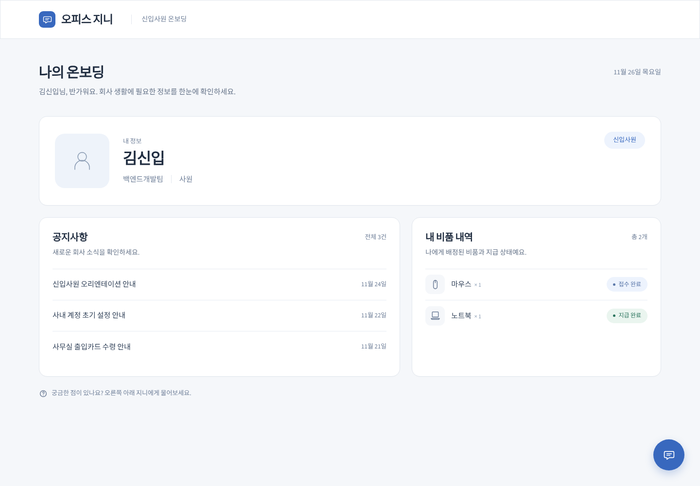
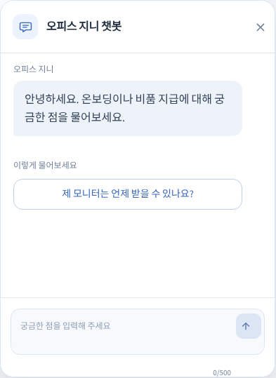
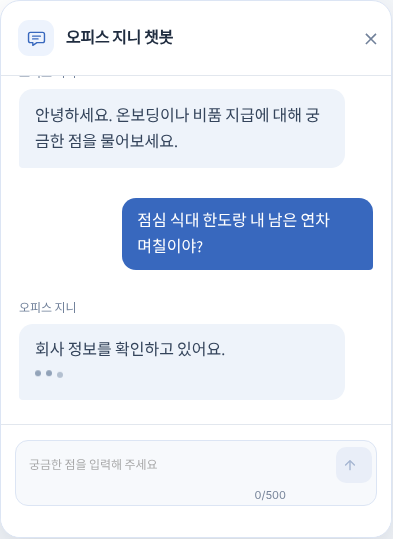
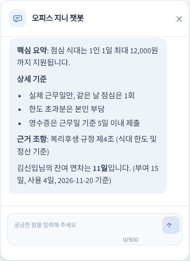
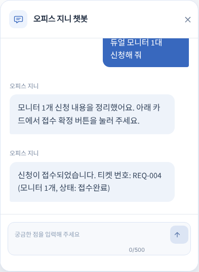
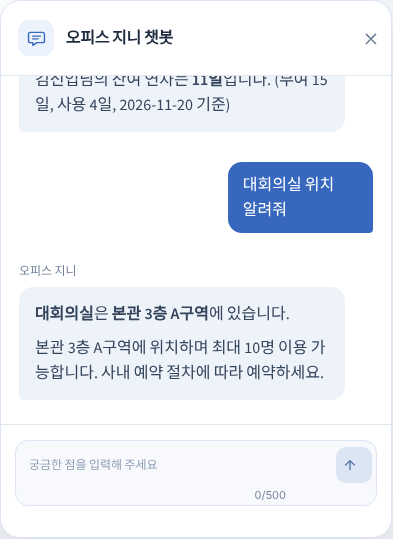
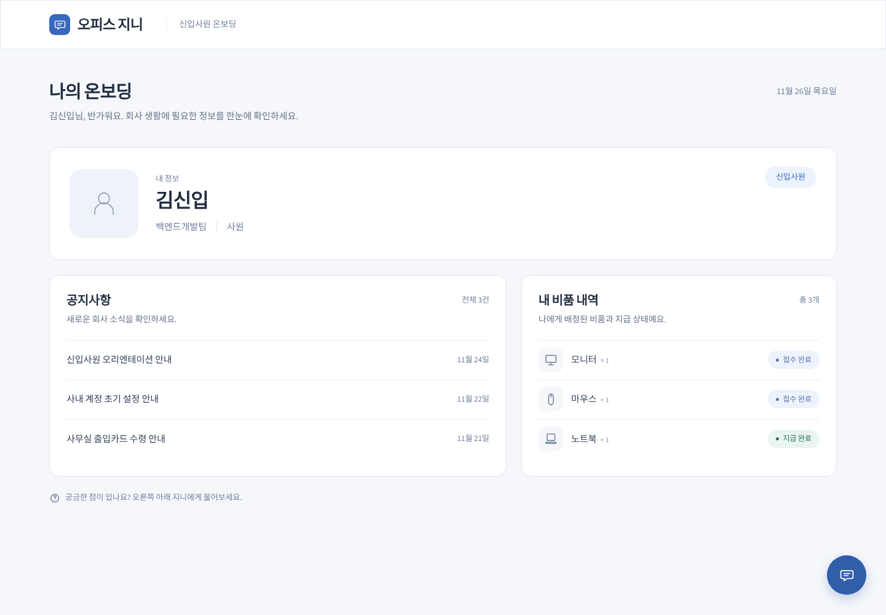
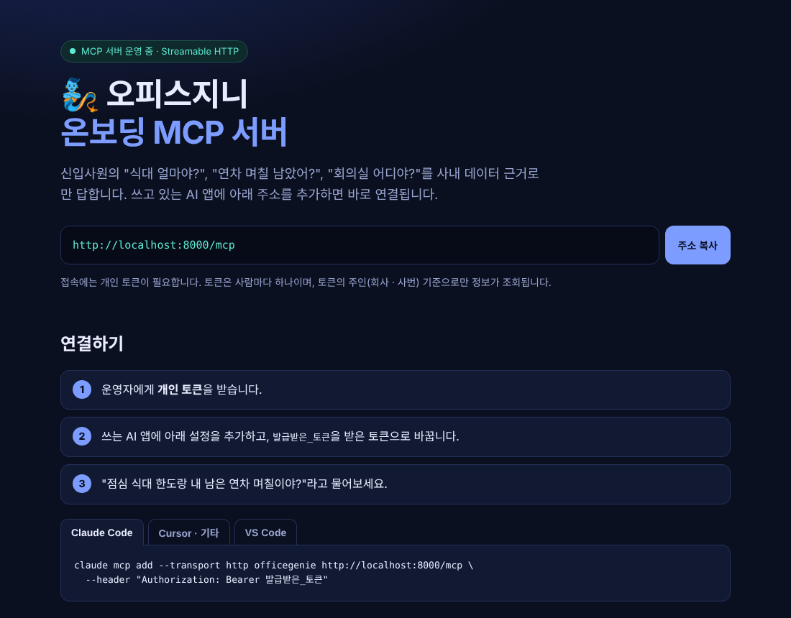
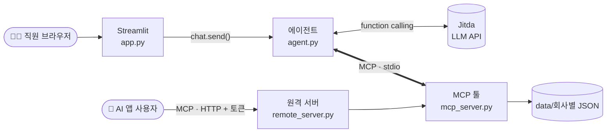

<div align="center">

# 🧞 오피스지니 · OfficeGenie

**중소기업 신규 입사자를 위한 온보딩 홈페이지 + MCP 서버**

"점심 식대 한도랑 내 남은 연차 며칠이야?" 한 문장이면 사내 규정, 내 인사 정보, 사무실 위치, 인수인계서, 비품 신청까지 끝.<br>
JSON 데이터 5종만 바꾸면 **코드 수정 없이 어느 회사에나** 적용됩니다.


[사용 방법](#-누가-어떻게-쓰나요) · [직원 가이드](#-직원-가이드-웹에서-쓰기) · [AI 앱 연결](#-ai-앱에서-쓰기-mcp) · [관리자 설치](#-관리자-가이드-설치와-운영) · [구조](#-아키텍처) · [보안 설계](#-보안-설계)



</div>

---

## 💡 왜 만들었나

인사팀이 따로 없는 중소기업의 신입사원은 첫 주에 같은 질문을 반복합니다. 식대는 얼마까지인지, 연차는 며칠 남았는지, 회의실은 어디인지, 내 업무는 무엇인지. 답은 메신저와 공유 드라이브, 선배의 기억 속에 흩어져 있고, 묻는 사람도 답하는 사람도 지칩니다.

오피스지니는 이 질문들을 **사내 데이터에 근거해서만** 답하는 도우미입니다. 모르는 건 지어내지 않고, 남의 정보는 보여주지 않으며, 모든 규정 답변에 근거 조항을 붙입니다.

## 🧭 누가 어떻게 쓰나요?

설치는 관리자가 한 번만 합니다. 직원은 **주소로 접속만** 하면 됩니다.

| 누가 | 어떻게 | 필요한 것 | 가이드 |
|---|---|---|---|
| 👩‍💼 **직원** | 브라우저로 사내 주소에 접속해 챗봇과 대화 | 접속 주소 | [직원 가이드](#-직원-가이드-웹에서-쓰기) |
| 🤖 **AI 앱 사용자** | 쓰고 있는 AI 앱(Claude Code, Cursor 등)에 MCP 서버 연결 | MCP 주소 + 개인 토큰 | [AI 앱 연결](#-ai-앱에서-쓰기-mcp) |
| 🛠 **관리자** | 서버 설치, 회사 데이터 등록, 주소·토큰 배포 | 이 저장소 + LLM API 키 | [관리자 가이드](#-관리자-가이드-설치와-운영) |

두 입구는 같은 MCP 서버와 같은 회사 데이터를 씁니다. 어디로 들어와도 권한 규칙과 신청 내역이 똑같이 적용됩니다.

---

## 👩‍💼 직원 가이드: 웹에서 쓰기

### 1. 접속하면 나의 온보딩 화면이 열립니다

관리자에게 받은 주소(예: `http://192.168.0.10:8501`)를 브라우저에 입력하면 맨 위 화면이 열립니다. 내 정보, 공지사항, 내 비품 지급 상태를 한눈에 볼 수 있습니다. 오른쪽 아래 파란 버튼을 누르면 챗봇이 열립니다.

### 2. 챗봇에게 물어보기

<table>
<tr>
<td align="center" width="33%"><br><sub><b>① 챗봇 열기</b><br>추천 질문을 누르거나 직접 입력</sub></td>
<td align="center" width="33%"><br><sub><b>② 회사 데이터 확인 중</b><br>답변이 준비되는 동안 입력이 잠깁니다</sub></td>
<td align="center" width="33%"><br><sub><b>③ 규정 + 내 정보 답변</b><br>핵심 요약 · 상세 기준 · 근거 조항</sub></td>
</tr>
</table>

이런 질문을 할 수 있습니다.

| 궁금한 것 | 이렇게 물어보세요 |
|---|---|
| 회사 규정 | "점심 식대 한도가 얼마야?", "재택근무 신청은 어떻게 해?" |
| 내 정보 | "내 남은 연차 며칠이야?" |
| 사무실 위치 | "대회의실 어디야?", "프린터 몇 층이야?" |
| 내 업무 | "내 직무 인수인계서 요약해 줘", "1주 차에 뭐 해야 해?" |
| 비품 · 계정 | "듀얼 모니터 1대 신청해 줘", "슬랙 계정 만들어 줘" |

### 3. 비품 신청하기

신청은 바로 접수되지 않고, **내용을 확인한 뒤 확정해야** 티켓이 발급됩니다. 확정하면 대시보드의 "내 비품 내역"에 바로 나타납니다.

<table>
<tr>
<td align="center" width="33%"><br><sub><b>① 신청 내용 확인</b><br>품목 · 수량 · 목적을 보고 [접수 확정]</sub></td>
<td align="center" width="33%"><br><sub><b>② 티켓 발급</b><br>티켓 번호(REQ-004)와 상태 안내</sub></td>
<td align="center" width="33%"><br><sub><b>장소 안내 예시</b><br>건물 · 층 · 구역과 이용 안내</sub></td>
</tr>
</table>

<p align="center"><br><sub>확정 직후 대시보드: 모니터가 "접수 완료"로 추가됨</sub></p>

> 회사가 허용하지 않은 품목이나 1인 수량 한도를 넘는 신청은 접수되지 않고 이유를 안내합니다.

### 4. 볼 수 없는 정보를 물으면


다른 직원의 연차, 다른 부서의 인수인계서, 회사에 등록되지 않은 정보는 보여주지 않고 문의처를 안내합니다. 챗봇이 추측해서 답을 지어내지 않습니다.

**알아두세요**

- 질문은 500자까지 입력할 수 있습니다.
- 챗봇 창을 닫으면 대화가 초기화됩니다.
- 답변이 오지 않으면 [다시 시도]를 누르세요.

<br clear="right">

> 화면은 실제 앱을 실행해 캡처했습니다. 답변 문구는 시연용 LLM 응답이며, 수치와 조항은 `data/bridgesoft/` 데이터 그대로입니다.

---

## 🤖 AI 앱에서 쓰기 (MCP)

이미 Claude Code, Cursor, VS Code 같은 AI 앱을 쓰고 있다면, 그 앱에 오피스지니를 연결해 대화창에서 바로 물어볼 수 있습니다. 회사 파일을 AI 앱에 올리지 않습니다. 데이터는 회사 서버에 그대로 있고, AI 앱은 질문할 때마다 필요한 결과만 받아 갑니다.

<p align="center"><br><sub>MCP 서버 주소로 접속하면 열리는 안내 홈페이지: 앱별 연결 설정을 복사할 수 있습니다</sub></p>

1. 관리자에게 **MCP 주소**와 **개인 토큰**을 받습니다.
2. 쓰는 AI 앱에 연결합니다.

   **Claude Code**
   ```bash
   claude mcp add --transport http officegenie http://<서버 주소>:8000/mcp \
     --header "Authorization: Bearer <개인 토큰>"
   ```

   **Cursor · 기타 (JSON 설정)**
   ```json
   {
     "mcpServers": {
       "officegenie": {
         "url": "http://<서버 주소>:8000/mcp",
         "headers": { "Authorization": "Bearer <개인 토큰>" }
       }
     }
   }
   ```
3. AI 앱에서 "점심 식대 한도랑 내 남은 연차 며칠이야?"라고 물어봅니다.

토큰이 곧 내 신원입니다. 토큰에 연결된 회사 · 사번 기준으로만 정보가 조회되고, 다른 사람의 정보를 지정할 방법은 없습니다. 토큰은 다른 사람과 공유하지 마세요.

---

## 🛠 관리자 가이드: 설치와 운영

### 1. 설치

```bash
git clone https://github.com/Byun-Gwan-Young/OG.git officegenie
cd officegenie
python -m venv .venv

# macOS / Linux
source .venv/bin/activate
# Windows PowerShell
Set-ExecutionPolicy -Scope Process Bypass
.\.venv\Scripts\Activate.ps1

pip install -r requirements.txt
python -m pytest -q        # API 키 없이 실행, 51 passed
```

### 2. LLM API 키 설정

`env.example`을 복사해 `.env`로 저장하고 값을 채웁니다. `.env`는 저장소에 올라가지 않습니다.

```bash
LLM_API_KEY=발급받은 키
LLM_BASE_URL=https://.../v1      # Jitda 설정 화면의 API 주소
```

### 3. 직원용 웹 화면 실행

```bash
streamlit run app.py
```

터미널에 나오는 `Network URL`(예: `http://192.168.0.10:8501`)을 직원들에게 공유합니다. 같은 네트워크에 있는 사람은 이 주소로 바로 접속할 수 있습니다. Windows에서는 처음 실행할 때 방화벽 창에서 "개인 네트워크 허용"을 선택하세요. MCP 서버는 앱이 자동으로 띄우므로 따로 실행하지 않습니다.

> 현재 웹 화면은 시연용으로 첫 번째 회사(브릿지소프트)의 EMP001(김신입) 계정으로 열립니다. 실제 도입 시에는 사내 로그인과 연결해 접속한 직원을 판별해야 합니다.

### 4. AI 앱용 MCP 서버 실행 (선택)

```bash
python scripts/issue_token.py bridgesoft EMP001 --name "김신입"   # 사람마다 토큰 발급
python scripts/issue_token.py --list                              # 발급 목록
python scripts/issue_token.py --revoke og_abcd1234                # 폐기 (앞 8자리)
python remote_server.py                                           # http://<서버 주소>:8000
```

| 주소 | 내용 | 토큰 |
|---|---|---|
| `/` | 안내 홈페이지 (앱별 연결 설정) | 불필요 |
| `/mcp` | MCP 엔드포인트 (Streamable HTTP) | **필요** |
| `/health` | 상태 확인 | 불필요 |

토큰을 발급하거나 폐기한 뒤에는 서버를 다시 시작하세요.

> ⚠️ 토큰은 `tokens.json`에 평문으로 저장되는 **개발 · 시연용 방식**입니다(저장소에는 올라가지 않음). 실제 운영에서는 OAuth 등 정식 인증과 HTTPS를 사용하세요. 사내 네트워크 밖에서 접속하게 하려면 서버 배포나 터널 도구가 필요합니다.

### 5. 운영 팁

- **데이터 수정:** `data/<회사>/` 의 JSON을 고치면 서버가 자동으로 다시 읽습니다. 재시작이 필요 없습니다.
- **시연 후 신청 내역 초기화:** `python mcp_server.py --reset-tickets`
- **새 회사 추가:** [다른 회사에 적용하기](#-다른-회사에-적용하기) 참고

---

## ✨ 기능

| | 기능 | 동작 |
|---|---|---|
| 📘 | **사내 규정 검색** | 회사 내규 우선 검색 → 핵심 요약 · 상세 기준 · 근거 조항. 표준취업규칙 조문은 "참고용"으로 표시 |
| 👤 | **본인 인사 정보** | 접속한 본인의 부서 · 직급 · 잔여 연차 |
| 📍 | **사내 장소 안내** | 건물 · 층 · 구역 + 출입 제한 안내 (별칭 인식: 프린터 → 복합기) |
| 📂 | **인수인계서 요약** | 소속 부서 문서만 → 핵심 업무 · 사용 툴 · 1주 차 할 일 |
| 🎫 | **비품 · 계정 신청** | 허용 품목 · 수량 한도 검증 → 요약 확인 → 티켓 발급 → 대시보드 반영 |
| 🏢 | **다기업 지원** | 같은 코드로 A사 식대 12,000원 · B사 15,000원처럼 회사별 규칙 적용 |

## 🏗 아키텍처



| 계층 | 파일 | 역할 |
|---|---|---|
| 웹 UI | `app.py` | 온보딩 대시보드, 챗봇 패널, 신청 확인 카드 |
| 에이전트 | `agent.py` | LLM 툴 호출 루프, 세션 값 주입, 입력 검증, 장애 대응 |
| MCP 툴 | `mcp_server.py` | 툴 5개 + UI 전용 툴 4개, 권한 · 비품 규칙 검증, 티켓 저장 |
| 원격 서버 | `remote_server.py` | HTTP MCP 엔드포인트, 토큰 인증, 안내 홈페이지 |
| 데이터 | `data/<company_id>/` | 회사별 표준 JSON 5종 |

웹 화면은 stdio 방식이라 `streamlit run app.py` 하나로 UI, 에이전트, MCP 툴이 함께 뜹니다. 원격 서버는 같은 툴 함수를 그대로 쓰고, 신원만 토큰에서 가져옵니다.

## 🧰 MCP 툴

| 툴 | 입력 (LLM이 채우는 값) | 반환 | 서버 쪽 검증 |
|---|---|---|---|
| `search_policy` | `query` | 관련 조항 최대 3개 + `citation` | 회사 내규 1.5배 가중, 점수 미달 시 `NOT_FOUND` |
| `get_employee_info` | `target` (타인을 물었을 때만) | 본인 인사 정보 · 연차 | 타인 사번 · 이름 → `PERMISSION_DENIED` |
| `get_office_location` | `place` | 건물 · 층 · 구역 · 안내 | 미등록 장소 → `NOT_FOUND` |
| `get_handover_doc` | `department` (부서를 지정했을 때만) | 핵심 업무 · 사용 툴 · 1주 차 할 일 | 타 부서 → `PERMISSION_DENIED` (부서 별칭 인식) |
| `create_support_ticket` | `item`, `quantity`, `purpose`, `request_type` | 신청 요약 (`NEEDS_CONFIRMATION`) | 허용 품목, 1인 수량 한도, 처리 중인 중복 신청 |

원격 서버에는 `confirm_support_ticket`(사용자 동의 후 발급)과 `get_my_tickets`(내 신청 현황)가 추가됩니다. 모든 툴은 같은 형식으로 응답합니다.

```json
{ "ok": true, "code": "OK", "message": "", "data": { } }
```

## 🔒 보안 설계

"프롬프트로 부탁하기"가 아니라 **구조적으로 불가능하게** 만드는 것이 원칙입니다.

1. **LLM은 사번을 모릅니다.** 웹에서는 에이전트가 세션 값을, 원격 서버에서는 토큰이 신원을 정합니다. LLM이 보는 툴 인자에는 회사 · 사번이 없습니다.
2. **권한은 서버가 판단합니다.** 타인 정보, 타 부서 문서 요청은 MCP 툴에서 차단되고 고정 안내 문구가 반환됩니다.
3. **없는 건 없다고 말합니다.** 데이터에 없는 장소 · 규정은 `NOT_FOUND`로 반환되며, 시스템 프롬프트가 추측을 금지합니다.
4. **티켓은 사람이 확정합니다.** 웹에서는 [접수 확정] 버튼을 눌러야만 발급되고, 10초 안의 같은 신청이 반복되면(버튼 연타) 티켓은 하나만 생깁니다.
5. **표준 조문과 내규를 구분합니다.** 표준취업규칙 기반 조항은 "참고용"으로 표시합니다.
6. **에러가 화면을 깨지 않습니다.** 서버 연결 실패, LLM 장애, 응답 시간 초과(30초)는 안내 문구와 [다시 시도] 버튼으로 바뀌고, 파이썬 예외는 화면에 나오지 않습니다.
7. **API 키는 MCP 서버로 넘어가지 않습니다.** LLM 키는 에이전트에만 있고, MCP 서버 프로세스 환경에서는 제거됩니다.

## 🏢 다른 회사에 적용하기

`data/` 아래에 회사 폴더를 하나 추가하면 됩니다. 코드는 건드리지 않습니다.

```text
data/
└── your-company/
    ├── policies.json    # 규정 (회사 내규 + 표준 참고 조문), 검색 키워드
    ├── employees.json   # 사원 (부서, 직급, 연차)
    ├── locations.json   # 장소 (건물, 층, 구역, 별칭), 미등록 장소 목록
    ├── handovers.json   # 부서별 인수인계서 (핵심 업무, 사용 툴, 1주 차 할 일)
    └── tickets.json     # 신청 내역, 허용 비품 목록, 1인 수량 한도, 안내 문구
```

포함된 가상 회사 두 곳이 같은 구조의 예시입니다.

| | (주)브릿지소프트 `bridgesoft` | (주)넥스트웨이브 `nextwave` |
|---|---|---|
| 사원 | 40명 · 7개 부서 | 40명 · 7개 부서 |
| 규정 | 120개 (내규 22 + 표준 참고 98) | 120개 (내규 22 + 표준 참고 98) |
| 장소 | 17곳 | 20곳 |
| 점심 식대 | 12,000원 | 15,000원 |
| 모니터 한도 | 1인 2대 | 1인 1대 |

> 회사, 사원, 내규는 모두 프로젝트용 가상 데이터입니다. 표준 참고 조문은 고용노동부 「표준취업규칙」(2026-02)을 바탕으로 합니다.

## 📁 프로젝트 구조

```text
officegenie/
├── app.py                 # 직원용 웹 화면 (Streamlit)
├── agent.py               # LLM ↔ MCP 에이전트
├── mcp_server.py          # MCP 툴 (stdio)
├── remote_server.py       # 원격 MCP 서버 (HTTP + 홈페이지 + 토큰 인증)
├── data/                  # 회사별 JSON 5종
├── seed/                  # 시연 초기화용 tickets.json 원본
├── assets/                # 로고
├── docs/
│   ├── ui_contract.md     # app.py ↔ agent.py 연동 규격
│   └── images/            # README 화면 캡처
├── scripts/
│   ├── cli_chat.py        # 터미널 테스트 채팅
│   └── issue_token.py     # 원격 서버 개인 토큰 발급 · 목록 · 폐기
├── tests/                 # pytest 51개 (API 키 없이 실행)
├── CLAUDE.md              # AI 코딩 도구용 작업 규칙
└── requirements.txt
```

## ⚙️ 설정

| 환경 변수 | 기본값 | 설명 |
|---|---|---|
| `LLM_API_KEY` | (필수) | Jitda LLM API 키 |
| `LLM_BASE_URL` | (필수) | Jitda API 주소 (`/v1`로 끝나는 주소) |
| `OFFICEGENIE_LLM_TIMEOUT` | `30` | LLM 응답 대기 시간(초) |
| `OFFICEGENIE_DATA_ROOT` | `./data` | 회사 데이터 폴더 위치 |
| `OFFICEGENIE_PORT` | `8000` | 원격 MCP 서버 포트 |
| `OFFICEGENIE_TOKENS` | `./tokens.json` | 원격 MCP 서버 토큰 파일 |

## 🧪 테스트

```bash
python -m pytest -q
```

API 키 없이 실행되며, 원본 `data/`는 임시 폴더에 복사해서 테스트하므로 바뀌지 않습니다.

| 파일 | 개수 | 검증 내용 |
|---|---|---|
| `test_tools.py` | 29 | 규정 검색, 장소, 인수인계서, 권한 차단, 비품 화이트리스트 · 수량 한도, 다기업 |
| `test_agent.py` | 13 | 실제 MCP 서버 + 가짜 LLM: 사번 위조 무시, 확인 절차, 입력 검증, 장애 대응 |
| `test_jitda_llm.py` | 5 | Jitda API 연동 형식, 키 비노출 (외부 요청 없음) |
| `test_remote.py` | 4 | 원격 서버: 잘못된 토큰 거부, 토큰별 신원 분리, 2단계 신청 |

## 🩺 문제 해결

| 증상 | 원인과 해결 |
|---|---|
| `requirements.txt`를 찾을 수 없음 | zip을 풀면 폴더가 한 겹 더 생깁니다. 안쪽 폴더로 `cd` 하세요. |
| `ModuleNotFoundError: dotenv` | `pip install -r requirements.txt`를 다시 실행하세요. |
| 챗봇이 "불러오지 못했어요"만 표시 | `.env`의 `LLM_API_KEY`, `LLM_BASE_URL`을 확인하세요. `python scripts/cli_chat.py`로 실행하면 `[오류 원인]`이 출력됩니다. |
| 다른 PC에서 웹 화면 접속 불가 | Windows 방화벽에서 "개인 네트워크 허용"을 선택하고, 같은 네트워크인지 확인하세요. |
| AI 앱에서 MCP 연결 시 401 | 토큰이 틀렸거나 서버 재시작 전 발급된 토큰입니다. `--list`로 확인 후 서버를 다시 시작하세요. |
| Windows에서 한글 깨짐 | `chcp 65001` 입력 후 다시 실행하세요. |

## 🗺 로드맵

- [x] MCP 툴 5종과 서버 쪽 권한 · 비품 검증
- [x] LLM 툴 호출 연동, 장애 시 키워드 대체 응답
- [x] 직원용 웹 화면 (대시보드 + 챗봇 + 신청 확인)
- [x] 원격 MCP 서버 + 개인 토큰 인증 + 안내 홈페이지
- [ ] 사내 로그인 연동 (접속한 직원 자동 판별)
- [ ] 원격 서버 배포 (HTTPS) 및 OAuth 인증
- [ ] 관리자 화면에서 티켓 상태 변경 (접수완료 → 승인 → 지급완료)

## 👥 팀

| 역할 | 담당 |
|---|---|
| 기획 · 발표 | 범위 관리, 사용자 테스트, 발표 |
| 테크 리드 | `mcp_server.py`, `agent.py`, `remote_server.py`, LLM 연동 |
| UI | `app.py` |
| 데이터 · QA | JSON 데이터, 테스트 시나리오 |

## 📄 라이선스

라이선스는 아직 정하지 않았습니다. 팀에서 정한 뒤 `LICENSE` 파일을 추가하세요.
