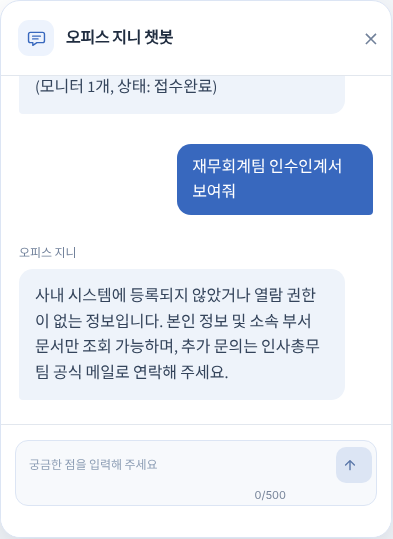

<div align="center">

# 🧞 오피스지니 · OfficeGenie

**중소기업 신규 입사자를 위한 온보딩 홈페이지 + MCP 서버**

"점심 식대 한도랑 내 남은 연차 며칠이야?" 한 문장이면 사내 규정, 내 인사 정보, 사무실 위치, 인수인계서, 비품 신청까지 끝.<br>
**회사 등록 → 데이터 업로드 → 사원에게 회사 코드 전달**, 이 세 단계면 코드 수정 없이 바로 사용합니다.


</div>

## 💡 소개

인사팀이 따로 없는 중소기업의 신입사원은 첫 주에 같은 질문을 반복합니다. 오피스지니는 이 질문들을 **사내 데이터에 근거해서만** 답하는 도우미입니다. 모르는 건 지어내지 않고, 남의 정보는 보여주지 않으며, 모든 규정 답변에 근거 조항을 붙입니다.

<table>
<tr>
<td align="center" width="33%"><br><sub><b>규정 + 내 정보</b><br>근거 조항까지 한 번에</sub></td>
<td align="center" width="33%"><br><sub><b>비품 신청</b><br>확인 후 확정하면 티켓 발급</sub></td>
<td align="center" width="33%"><br><sub><b>권한 밖 정보 차단</b><br>추측하지 않고 문의처 안내</sub></td>
</tr>
</table>

## 🧭 누가 어떻게 쓰나요?

서비스는 운영자가 한 번 배포합니다. 회사는 **웹에서 등록하고 데이터만 올리면** 되고, 직원은 **회사 코드 + 사번 + 비밀번호로 로그인**만 하면 됩니다.

| 누가 | 어떻게 | 가이드 |
|---|---|---|
| 👩‍💼 **직원** | 회사 코드 · 사번 · 비밀번호로 로그인해 홈(사원증) · 공지사항 · 자료실 · 비품 신청과 챗봇 사용. 휴대폰 홈 화면에 설치 가능 | **[직원 가이드 →](docs/guide-employee.md)** |
| 🏢 **회사 관리자** | 회사 등록 → 회사 코드 확인 → 양식대로 규정·사원 데이터 업로드 → 미리보기 → 반영, 신청·계정 관리 | **[관리자 가이드 1부 →](docs/guide-admin.md#1부-회사-관리자)** |
| 🤖 **AI 앱 사용자** | 쓰고 있는 AI 앱(Claude Code, Cursor 등)에 MCP 서버 연결 | **[AI 앱 연결 가이드 →](docs/guide-mcp.md)** |
| 🛠 **서비스 운영자** | 서버 배포, 가입 코드 설정, 운영 스크립트 · 토큰 배포 | **[관리자 가이드 2부 →](docs/guide-admin.md#2부-서비스-운영자)** |

두 입구는 같은 MCP 서버와 같은 회사 데이터를 씁니다. 어디로 들어와도 권한 규칙과 신청 내역이 똑같이 적용됩니다.

## ✨ 주요 기능

| | 기능 | 예시 질문 |
|---|---|---|
| 📘 | 사내 규정 검색 (근거 조항 포함) | "점심 식대 한도가 얼마야?" |
| 👤 | 본인 인사 정보 · 잔여 연차 | "내 남은 연차 며칠이야?" |
| 📍 | 사내 장소 안내 | "대회의실 어디야?" |
| 📂 | 소속 부서 인수인계서 요약 | "1주 차에 뭐 해야 해?" |
| 🎫 | 비품 · 계정 신청 (확인 후 발급) | "듀얼 모니터 1대 신청해 줘" |
| 🏢 | 다기업 지원 (회사 등록 + 데이터 업로드) | A사 식대 12,000원 · B사 15,000원 |
| 🔐 | 회사 코드 로그인 · 관리자 화면 | 업로드 미리보기 · 신청 승인 · 계정 잠금 해제 |

## 🚀 빠른 시작

```bash
git clone https://github.com/Byun-Gwan-Young/OG.git officegenie && cd officegenie
python -m venv .venv && source .venv/bin/activate   # Windows: .\.venv\Scripts\Activate.ps1
pip install -r requirements.txt
cp env.example .env                                  # LLM_API_KEY, LLM_BASE_URL (선택: DATABASE_URL) 입력
python scripts/import_company.py --all               # 시연 회사 JSON → DB (DATABASE_URL이 없으면 로컬 SQLite), 회사 코드 출력
python scripts/pwa_setup.py                          # PWA 설정 (streamlit을 다시 설치할 때마다)
streamlit run app.py                                 # 회사 코드 + EMP001 + data/의 비밀번호로 로그인
```

새 회사는 첫 화면의 **회사 등록**으로 만들고, 관리자 화면에서 데이터를 올리면 됩니다. 시연 회사의 관리자 계정은 `python scripts/set_admin_password.py bridgesoft`로 만듭니다.

**배포 주소** (Render, [배포 방법](docs/guide-admin.md#6-render-배포하기))

| 서비스 | 주소 |
|---|---|
| 웹 | `https://<officegenie-web 주소>.onrender.com` |
| AI 앱 연결(MCP) | `https://<officegenie-mcp 주소>.onrender.com/mcp` — 토큰은 웹 홈의 **AI 앱 연결** 카드에서 발급 |

무료 플랜은 한동안 접속이 없으면 잠들어 첫 로딩에 최대 1분 걸립니다. 시연 전에는 `python scripts/warmup.py <웹 주소> <MCP 주소>`로 깨워 두세요.

자세한 설치, Render 배포, MCP 서버, 문제 해결은 [관리자 가이드](docs/guide-admin.md)를 보세요.

## 📚 문서

| 문서 | 내용 |
|---|---|
| [직원 가이드](docs/guide-employee.md) | 화면으로 보는 사용법: 질문하기, 비품 신청, 권한 안내 |
| [AI 앱 연결 가이드](docs/guide-mcp.md) | Claude Code · Cursor · VS Code에 MCP 서버 연결 |
| [관리자 가이드](docs/guide-admin.md) | 설치, 실행, 토큰 관리, 운영, 문제 해결, 설정 값 |
| [구조와 보안](docs/architecture.md) | 아키텍처, MCP 툴, 보안 설계, 다른 회사 적용, 테스트 |
| [UI 연동 규격](docs/ui_contract.md) | `app.py` ↔ `agent.py` 함수와 반환 형식 (개발자용) |

## 🗺 로드맵

- [x] MCP 툴 5종과 서버 쪽 권한 · 비품 검증
- [x] 직원용 웹 화면 (대시보드 + 챗봇 + 신청 확인)
- [x] 메뉴형 화면(PC 상단 메뉴 · 모바일 하단 탭바), 사원증 홈, 자료실, 비품 신청 메뉴, 새로고침 후 로그인 유지
- [x] PWA(홈 화면 설치, 오프라인 안내) — `python scripts/pwa_setup.py`
- [x] 원격 MCP 서버 + 개인 토큰 인증 + 안내 홈페이지
- [ ] 사내 로그인 연동 (접속한 직원 자동 판별)
- [ ] 원격 서버 배포 (HTTPS) 및 OAuth 인증
- [ ] 관리자 화면에서 티켓 상태 변경

## 👥 팀

| 역할 | 담당 |
|---|---|
| 기획 · 발표 | 범위 관리, 사용자 테스트, 발표 |
| 테크 리드 | `mcp_server.py`, `agent.py`, `remote_server.py`, LLM 연동 |
| UI | `app.py` |
| 데이터 · QA | JSON 데이터, 테스트 시나리오 |

## 📄 라이선스

라이선스는 아직 정하지 않았습니다. 팀에서 정한 뒤 `LICENSE` 파일을 추가하세요.
