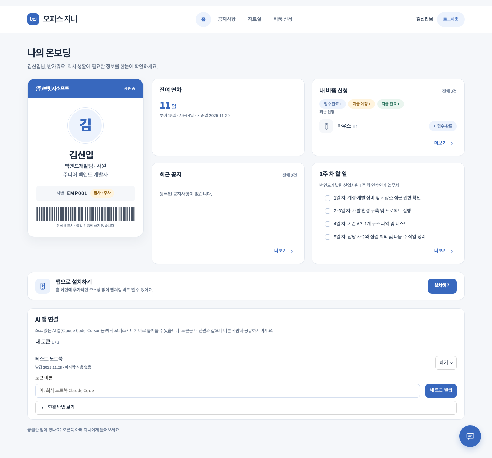
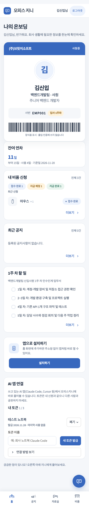
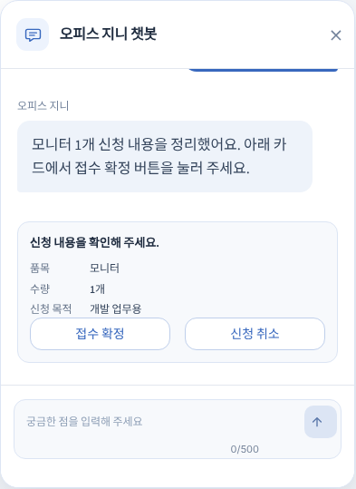

<div align="center">

# 🧞 오피스지니 · OfficeGenie

**신규 입사자를 위한 온보딩 웹앱 + AI 비서 + MCP 서버**

"점심 식대 한도랑 내 남은 연차 며칠이야?" 한 문장이면 사내 규정, 내 인사 정보, 사무실 위치, 인수인계서, 비품 신청까지 끝.<br>
**회사 등록 → 데이터 업로드 → 사원에게 회사 코드 전달**, 이 세 단계면 코드 수정 없이 바로 씁니다.

[**🌐 웹 서비스**](https://officegenie-web.duckdns.org) · [**🤖 MCP 서버**](https://officegenie-mcp.duckdns.org) · [직원 가이드](docs/guide-employee.md) · [관리자 가이드](docs/guide-admin.md)




</div>

## 💡 왜 만들었나요?

신입사원은 첫 주에 같은 질문을 반복하고, 선배와 담당자는 같은 답을 반복합니다. 연차가 쌓여도 자주 안 쓰는 규정은 매번 다시 찾아봅니다. 오피스지니는 이 질문들에 **회사 데이터에 근거해서만** 답합니다.

- **지어내지 않습니다.** 규정 답변에는 근거 조항을 붙이고, 데이터에 없으면 문의처를 안내합니다.
- **남의 정보는 보여 주지 않습니다.** 권한 검사는 프롬프트가 아니라 서버에서 합니다.
- **확인 없이 처리하지 않습니다.** 비품 신청은 미리보기를 보고 확정해야 접수됩니다.

## 📱 화면

<table>
<tr>
<td align="center" width="25%"><br><sub><b>사원증 홈</b><br>연차 · 비품 · 공지 · 1주 차 할 일</sub></td>
<td align="center" width="25%"><br><sub><b>AI 비서</b><br>규정 + 내 정보를 근거 조항과 함께</sub></td>
<td align="center" width="25%"><br><sub><b>비품 신청</b><br>미리보기 → 확정하면 접수</sub></td>
<td align="center" width="25%"><br><sub><b>권한 밖 정보 차단</b><br>추측하지 않고 문의처 안내</sub></td>
</tr>
</table>

PC에서는 상단 메뉴, 휴대폰에서는 하단 탭바로 바뀌고, **홈 화면에 앱으로 설치**할 수 있습니다(PWA).

## 🧭 누가 어떻게 쓰나요?

| 누가 | 어떻게 | 가이드 |
|---|---|---|
| 👩‍💼 **직원** | 회사 코드 · 사번 · 비밀번호로 로그인 → 홈(사원증) · 공지사항 · 자료실 · 비품 신청 · AI 비서. 휴대폰에 앱으로 설치 | [직원 가이드 →](docs/guide-employee.md) |
| 🏢 **회사 관리자** | 회사 등록 → 회사 코드 확인 → 양식대로 데이터 업로드 → 미리보기 → 반영. 공지 · 자료 · 신청 · 계정 관리 | [관리자 가이드 1부 →](docs/guide-admin.md#1부-회사-관리자) |
| 🤖 **AI 앱 사용자** | 웹 홈의 **AI 앱 연결** 카드에서 개인 토큰 발급 → Claude Code · Cursor 등에 연결 | [AI 앱 연결 가이드 →](docs/guide-mcp.md) |
| 🛠 **서비스 운영자** | EC2 배포, 가입 코드, 운영 스크립트 | [관리자 가이드 2부 →](docs/guide-admin.md#2부-서비스-운영자) |

웹과 AI 앱, 두 입구는 **같은 MCP 툴과 같은 DB**를 씁니다. 어디로 들어와도 권한 규칙과 신청 내역이 똑같이 적용됩니다.

## ✨ 주요 기능

| | 기능 | 예시 |
|---|---|---|
| 📘 | 사내 규정 검색 (근거 조항 포함) | "점심 식대 한도가 얼마야?" → 12,000원, 복리후생 규정 제4조 |
| 👤 | 본인 인사 정보 · 잔여 연차 | "내 남은 연차 며칠이야?" → 11일 |
| 📍 | 사내 장소 안내 | "대회의실 어디야?" → 본관 3층 A구역 |
| 📂 | 소속 부서 인수인계서 요약 | "1주 차에 뭐 해야 해?" |
| 🎫 | 비품 · 계정 신청 (확인 후 접수), 내 신청 현황 | "노트북 거치대 1개 신청해 줘" |
| 📢 | 공지사항 · 자료실 (부서 전용 자료는 서버에서 부서 확인) | 관리자가 올리면 사원 화면에 바로 반영 |
| 🏢 | 다기업 SaaS: 회사 등록 · 회사 코드 · 데이터 업로드 | A사 식대 12,000원 · B사 15,000원 |
| 🤖 | 원격 MCP 서버 + 사원 개인 토큰 (발급 · 폐기) | Claude Code에서 "내 연차 알려줘" |
| 📲 | PWA 앱 설치 (안드로이드 · 아이폰 · PC) | 홈 화면 아이콘으로 바로 실행 |

## 🏗 구조

```
 휴대폰 · PC 브라우저 (PWA)            AI 앱 (Claude Code, Cursor …)
          │ HTTPS                               │ HTTPS + 개인 토큰
          ▼                                     ▼
 ┌──────────────── AWS EC2 서울 · Docker Compose ────────────────┐
 │  Caddy (자동 HTTPS, Let's Encrypt)                             │
 │     ├─ officegenie-web  → Streamlit app.py ─ agent.py ─┐       │
 │     └─ officegenie-mcp  → remote_server.py ────────────┤       │
 │                                         mcp_server.py (MCP 툴) │
 └──────────────────────────────────────────────┬────────────────┘
                     Jitda LLM API (jitda-chat) │ storage.py
                                                ▼
                                       Neon PostgreSQL
```

- **LLM은 툴만 고릅니다.** `company_id`, `employee_id`, 확정 여부는 LLM에게 보이지 않고, agent가 로그인 세션 값으로 넣습니다.
- **권한과 한도는 서버가 검사합니다.** 타인 정보, 타 부서 문서, 비품 화이트리스트와 수량 한도를 `mcp_server.py`에서 확인합니다.
- **비밀번호와 토큰은 해시로만 저장합니다.** 로그인 5회 실패 시 10분 잠금, 토큰은 폐기 즉시 거부됩니다.

자세한 내용은 [구조와 보안](docs/architecture.md)에 있습니다.

## 🚀 빠른 시작 (로컬)

```bash
git clone https://github.com/Byun-Gwan-Young/OG.git officegenie && cd officegenie
python -m venv .venv && source .venv/bin/activate   # Windows: .\.venv\Scripts\Activate.ps1
pip install -r requirements.txt
cp env.example .env                                  # LLM_API_KEY, LLM_BASE_URL 입력 (선택: DATABASE_URL)
python scripts/import_company.py --all               # 시연 회사 4곳 → DB (DATABASE_URL이 없으면 로컬 SQLite), 회사 코드 출력
python scripts/pwa_setup.py                          # PWA 설정 (streamlit을 다시 설치할 때마다)
streamlit run app.py                                 # 회사 코드 + EMP001 + data/의 비밀번호로 로그인
```

새 회사는 첫 화면의 **회사 등록**으로 만들고, 관리자 화면에서 데이터를 올립니다. 시연 회사의 관리자 계정은 `python scripts/set_admin_password.py bridgesoft`로 만듭니다.

## ☁️ 배포 (AWS EC2)

| 서비스 | 주소 |
|---|---|
| 웹 | https://officegenie-web.duckdns.org |
| AI 앱 연결(MCP) | `https://officegenie-mcp.duckdns.org/mcp` (토큰은 웹 홈의 **AI 앱 연결** 카드에서 발급) |

```bash
# 서버 (Ubuntu, 처음 한 번)
bash deploy/setup_server.sh
cp env.production.example .env.production   # DATABASE_URL, LLM_API_KEY, 도메인, ACME_EMAIL 등 실제 값으로
bash deploy/deploy.sh                       # 업데이트할 때도 git pull 후 이것만

# 내 PC에서 점검
python scripts/deploy_check.py https://officegenie-web.duckdns.org https://officegenie-mcp.duckdns.org
```

EC2 생성, 보안 그룹, 도메인, 비용 정리까지 [관리자 가이드 · AWS EC2 배포하기](docs/guide-admin.md#6-aws-ec2-배포하기)에 단계별로 있습니다.

## 🧪 테스트

```bash
pytest -q --durations=10     # LLM·공유 DB 없이 실행, 원본 data/를 건드리지 않음
```

MCP 툴 권한, 로그인 잠금, 관리자 업로드, PWA 주입, 실제 브라우저 로그인 · 앱 설치 · 아이콘 표시, 배포 설정까지 **292개 테스트**가 통과합니다. PostgreSQL 전용 테스트는 `TEST_DATABASE_URL`을 넣고 `--pg-all`로 돌립니다.

## 📚 문서

| 문서 | 내용 |
|---|---|
| [직원 가이드](docs/guide-employee.md) | 로그인, 메뉴, 챗봇, 비품 신청, AI 앱 연결 카드, 앱 설치 방법 |
| [AI 앱 연결 가이드](docs/guide-mcp.md) | Claude Code · Cursor · VS Code에 MCP 서버 연결 |
| [관리자 가이드](docs/guide-admin.md) | 회사 관리자 사용법, 설치, DB, EC2 배포, 운영 |
| [구조와 보안](docs/architecture.md) | 아키텍처, MCP 툴, 보안 설계, 다른 회사 적용 |
| [UI 연동 규격](docs/ui_contract.md) | `app.py` ↔ `agent.py` 함수와 반환 형식 (개발자용) |
| [화면 점검 기록](docs/ui-review.md) | 배포 후 아이콘 깨짐 원인(HTTP/3), 화면별 수정, 수정 전·후 스크린샷 |

## 🗺 로드맵

- [x] MCP 툴과 서버 쪽 권한 · 비품 검증
- [x] JSON → Neon PostgreSQL 전환
- [x] SaaS: 회사 등록, 회사 코드 로그인, 관리자 업로드 · 미리보기
- [x] 메뉴형 화면(사원증 홈, 공지사항, 자료실, 비품 신청), PC · 모바일 레이아웃
- [x] PWA 앱 설치 (안드로이드 · 아이폰 · PC)
- [x] 원격 MCP 서버 + 사원 개인 토큰 발급 · 폐기
- [x] AWS EC2 배포 + 자동 HTTPS
- [ ] 사내 SSO 연동, MCP OAuth 인증
- [ ] 관리자 화면에서 신청 상태 알림 (메일 · 메신저)

## 👥 팀

| 역할 | 담당 |
|---|---|
| 기획 · 발표 | 범위 관리, 사용자 테스트, 발표 |
| 테크 리드 | MCP 서버, LLM 연동, DB, 배포 |
| UI | 웹 화면, PWA |
| 데이터 · QA | 회사 데이터, 테스트 시나리오 |

## 📄 라이선스

라이선스는 아직 정하지 않았습니다. 팀에서 정한 뒤 `LICENSE` 파일을 추가하세요.
