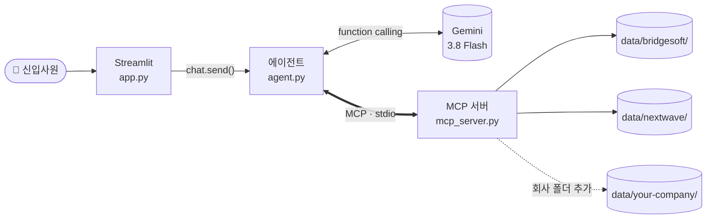

<div align="center">

# 🧞 오피스지니 · OfficeGenie

**중소기업 신규 입사자를 위한 MCP 기반 온보딩 에이전트**

"점심 식대 한도랑 내 남은 연차 며칠이야?" 한 문장이면 사내 규정, 내 인사 정보, 사무실 위치, 인수인계서, 비품 신청까지 끝.<br>
JSON 데이터 5종만 바꾸면 **코드 수정 없이 어느 회사에나** 적용됩니다.


[빠른 시작](#-빠른-시작) · [기능](#-기능) · [구조](#-아키텍처) · [다른 회사에 적용하기](#-다른-회사에-적용하기) · [보안 설계](#-보안-설계) · [로드맵](#-로드맵)

</div>

---

## 💡 왜 만들었나

인사팀이 따로 없는 중소기업의 신입사원은 첫 주에 같은 질문을 반복합니다. 식대는 얼마까지인지, 연차는 며칠 남았는지, 회의실은 어디인지, 내 업무는 무엇인지. 답은 메신저와 공유 드라이브, 선배의 기억 속에 흩어져 있고, 묻는 사람도 답하는 사람도 지칩니다.

오피스지니는 이 질문들을 **사내 데이터에 근거해서만** 답하는 대화형 도우미입니다. 모르는 건 지어내지 않고, 남의 정보는 보여주지 않으며, 모든 규정 답변에 근거 조항을 붙입니다.

## ✨ 기능

| | 기능 | 예시 질문 | 동작 |
|---|---|---|---|
| 📘 | **사내 규정 검색** | "점심 식대 한도가 얼마야?" | 회사 내규 우선 검색 → 핵심 요약 · 상세 기준 · 근거 조항 |
| 👤 | **본인 인사 정보** | "내 남은 연차 며칠이야?" | 로그인한 본인의 부서 · 직급 · 잔여 연차 |
| 📍 | **사내 장소 안내** | "대회의실 어디야?" | 건물 · 층 · 구역 + 출입 제한 안내 (별칭 인식: 프린터 → 복합기) |
| 📂 | **인수인계서 요약** | "내 직무 인수인계서 요약해 줘" | 소속 부서 문서만 → 핵심 업무 · 사용 툴 · 1주 차 할 일 |
| 🎫 | **비품 · 계정 신청** | "듀얼 모니터 1대 신청해 줘" | 허용 품목 · 수량 한도 검증 → 요약 확인 → 티켓 발급 (REQ-004) |
| 🏢 | **다기업 전환** | 화면에서 회사 선택 | 같은 코드로 A사 식대 12,000원 ↔ B사 15,000원 |

### 대화 예시

```text
나    점심 식대 한도랑 내 남은 연차 며칠이야?

지니  핵심 요약: 점심 식대는 1인 1일 최대 12,000원까지 지원됩니다.
      상세 기준:
       - 실제 근무일만 해당, 같은 날 점심은 1회만 신청
       - 한도 초과분은 본인 부담, 영수증은 근무일 기준 5일 이내 제출
      근거 조항: 복리후생 규정 제4조 (식대 한도 및 정산 기준)

      김신입님의 잔여 연차는 11일입니다. (부여 15일, 사용 4일, 2026-11-20 기준)
```

```text
나    재무회계팀 인수인계서 보여줘

지니  사내 시스템에 등록되지 않았거나 열람 권한이 없는 정보입니다.
      본인 정보 및 소속 부서 문서만 조회 가능하며,
      추가 문의는 인사총무팀 공식 메일로 연락해 주세요.
```

> 응답 문구는 형식 예시입니다. 수치와 조항은 `data/bridgesoft/` 데이터 기준이며 테스트로 검증합니다.

## 🚀 빠른 시작

### 1. 설치

```bash
git clone <저장소 주소> officegenie
cd officegenie
python -m venv .venv

# macOS / Linux
source .venv/bin/activate
# Windows PowerShell
Set-ExecutionPolicy -Scope Process Bypass
.\.venv\Scripts\Activate.ps1

pip install -r requirements.txt
```

### 2. 테스트 (API 키 없이 실행)

```bash
python -m pytest -q
# 42 passed
```

### 3. Gemini API 키 설정

[Google AI Studio](https://aistudio.google.com/)에서 무료 키를 발급받습니다.

```bash
# macOS / Linux
export GEMINI_API_KEY="발급받은 키"
# Windows PowerShell
$env:GEMINI_API_KEY="발급받은 키"
```

### 4. 실행

```bash
# 터미널 채팅으로 바로 확인
python scripts/cli_chat.py bridgesoft EMP001

# 웹 UI
streamlit run app.py
```

> MCP 서버는 따로 실행하지 않습니다. 에이전트가 첫 요청 때 자동으로 띄웁니다.

## 🏗 아키텍처



| 계층 | 파일 | 역할 |
|---|---|---|
| UI | `app.py` | 회사 · 사번 선택, 채팅, 잔여 연차와 신청 현황 사이드바 |
| 에이전트 | `agent.py` | Gemini 툴 호출 루프, 세션 값 주입, 입력 검증, 장애 대응 |
| MCP 서버 | `mcp_server.py` | 툴 5개 + UI 전용 툴 4개, 권한 · 비품 규칙 검증, 티켓 저장 |
| 데이터 | `data/<company_id>/` | 회사별 표준 JSON 5종 |

**왜 stdio인가?** `streamlit run app.py` 명령 하나로 UI, 에이전트, MCP 서버가 함께 뜹니다. 포트 충돌이나 서버 실행을 잊는 실수가 없어 시연 환경에서 안전합니다.

## 🧰 MCP 툴

LLM에게는 아래 5개만 공개됩니다.

| 툴 | 입력 (LLM이 채우는 값) | 반환 | 서버 쪽 검증 |
|---|---|---|---|
| `search_policy` | `query` | 관련 조항 최대 3개 + `citation` | 회사 내규 1.5배 가중, 점수 미달 시 `NOT_FOUND` |
| `get_employee_info` | `target` (타인을 물었을 때만) | 본인 인사 정보 · 연차 | 타인 사번 · 이름 → `PERMISSION_DENIED` |
| `get_office_location` | `place` | 건물 · 층 · 구역 · 안내 | 미등록 장소 → `NOT_FOUND` |
| `get_handover_doc` | `department` (부서를 지정했을 때만) | 핵심 업무 · 사용 툴 · 1주 차 할 일 | 타 부서 → `PERMISSION_DENIED` (부서 별칭 인식) |
| `create_support_ticket` | `item`, `quantity`, `purpose`, `request_type` | 신청 요약 (`NEEDS_CONFIRMATION`) | 허용 품목, 1인 수량 한도, 처리 중인 중복 신청 |

모든 툴은 같은 형식으로 응답합니다.

```json
{ "ok": true, "code": "OK", "message": "", "data": { } }
```

## 🔒 보안 설계

"프롬프트로 부탁하기"가 아니라 **구조적으로 불가능하게** 만드는 것이 원칙입니다.

1. **LLM은 사번을 모릅니다.** `company_id` · `employee_id`는 LLM에게 보이는 툴 스키마에서 제거되고, 에이전트가 화면에서 선택한 세션 값을 주입합니다. LLM이 다른 사번을 끼워 넣어도 무시됩니다.
2. **권한은 서버가 판단합니다.** 타인 정보, 타 부서 문서 요청은 MCP 서버에서 차단되고 고정 안내 문구가 반환됩니다.
3. **없는 건 없다고 말합니다.** 데이터에 없는 장소 · 규정은 `NOT_FOUND`로 반환되며, 시스템 프롬프트가 추측을 금지합니다.
4. **티켓은 사람이 확정합니다.** LLM은 신청 미리보기만 만들 수 있습니다. 실제 발급은 사용자가 [접수 확정]을 누르거나 "네"라고 답했을 때만 이루어집니다. 10초 안의 같은 신청이 반복되면(버튼 연타) 티켓은 하나만 생깁니다.
5. **표준 조문과 내규를 구분합니다.** 고용노동부 표준취업규칙 기반 조항은 "참고용"으로 표시해, 회사가 실제로 채택한 규정처럼 보이지 않게 합니다.
6. **에러가 화면을 깨지 않습니다.** 서버 연결 실패, Gemini 장애, 응답 시간 초과(30초)는 모두 안내 문구로 바뀌고, 파이썬 예외(Traceback)는 UI로 올라가지 않습니다. Gemini가 응답하지 않으면 키워드 검색 결과로 대신 답합니다.

## 🏢 다른 회사에 적용하기

`data/` 아래에 회사 폴더를 하나 추가하면 회사 선택 목록에 자동으로 나타납니다. 코드는 건드리지 않습니다.

```text
data/
└── your-company/
    ├── policies.json    # 규정 (회사 내규 + 표준 참고 조문), 검색 키워드
    ├── employees.json   # 사원 (부서, 직급, 연차)
    ├── locations.json   # 장소 (건물, 층, 구역, 별칭), 미등록 장소 목록
    ├── handovers.json   # 부서별 인수인계서 (핵심 업무, 사용 툴, 1주 차 할 일)
    └── tickets.json     # 신청 내역, 허용 비품 목록, 1인 수량 한도, 안내 문구
```

포함된 가상 회사 두 곳이 같은 구조의 예시입니다.

| | (주)브릿지소프트 `bridgesoft` | (주)넥스트웨이브 `nextwave` |
|---|---|---|
| 사원 | 40명 · 7개 부서 | 40명 · 7개 부서 |
| 규정 | 120개 (내규 22 + 표준 참고 98) | 120개 (내규 22 + 표준 참고 98) |
| 장소 | 17곳 | 20곳 |
| 점심 식대 | 12,000원 | 15,000원 |
| 모니터 한도 | 1인 2대 | 1인 1대 |

> 회사, 사원, 내규는 모두 프로젝트용 가상 데이터입니다. 표준 참고 조문은 고용노동부 「표준취업규칙」(2026-02)을 바탕으로 합니다.

## 📁 프로젝트 구조

```text
officegenie/
├── mcp_server.py          # FastMCP 서버
├── agent.py               # Gemini ↔ MCP 에이전트 (UI가 사용하는 인터페이스)
├── app.py                 # Streamlit UI
├── data/                  # 회사별 JSON 5종
├── seed/                  # 시연 초기화용 tickets.json 원본
├── docs/
│   └── ui_contract.md     # app.py ↔ agent.py 연동 규격
├── scripts/
│   └── cli_chat.py        # 터미널 테스트 채팅
├── tests/
│   ├── test_tools.py      # 툴 단위 테스트 (29개)
│   └── test_agent.py      # 실제 MCP 서버 + 가짜 LLM 통합 테스트 (13개)
├── CLAUDE.md              # AI 코딩 도구용 작업 규칙
└── requirements.txt
```

## ⚙️ 설정

| 환경 변수 | 기본값 | 설명 |
|---|---|---|
| `GEMINI_API_KEY` | (필수) | Google AI Studio API 키 |
| `OFFICEGENIE_MODEL` | `gemini-3.8-flash` | 사용할 Gemini 모델 |
| `OFFICEGENIE_THINKING_LEVEL` | `low` | 추론 강도 `low` · `medium` · `high` (낮을수록 빠름) |
| `OFFICEGENIE_LLM_TIMEOUT` | `30` | Gemini 응답 대기 시간(초) |
| `OFFICEGENIE_DATA_ROOT` | `./data` | 회사 데이터 폴더 위치 |

## 🧪 테스트

```bash
python -m pytest -q                     # 전체
python -m pytest -q tests/test_tools.py # 툴만
```

API 키 없이 실행되며, 원본 `data/`는 임시 폴더에 복사해서 테스트하므로 바뀌지 않습니다. 검증 범위는 다음과 같습니다.

- **정상 상황:** 식대 12,000원 + 잔여 연차 11일, 대회의실 본관 3층 A구역, 인수인계서 3단 요약, 확정 후 REQ-004 발급과 현황판 갱신
- **예외 상황:** 미등록 장소(사내 수면실), 타 부서 문서, 타인 연차, 등록 안 된 비품, 수량 초과, 공백 · 500자 초과 입력
- **장애 상황:** MCP 서버 연결 실패, Gemini 오류와 키워드 대체 응답, 응답 지연 시간 초과
- **보안:** LLM의 사번 위조 무시, 세션 인자 비공개, LLM이 확정을 시도해도 미리보기로만 처리
- **다기업:** 같은 서버에서 A사 ↔ B사 전환

시연 후 티켓 데이터 초기화:

```bash
python mcp_server.py --reset-tickets
```

## 🩺 문제 해결

| 증상 | 원인과 해결 |
|---|---|
| `requirements.txt`를 찾을 수 없음 | zip을 풀면 `officegenie` 폴더가 한 겹 더 생깁니다. 안쪽 폴더로 `cd` 하세요. |
| `code=FALLBACK`, `[오류 원인] GEMINI_API_KEY가 설정되지 않았습니다` | 터미널을 새로 열면 키가 사라집니다. 키를 다시 설정하세요. |
| `503 UNAVAILABLE` (high demand) | 구글 쪽 일시적 과부하입니다. 잠시 후 재시도하거나 `OFFICEGENIE_MODEL=gemini-3.6-flash`로 바꿔 테스트하세요. |
| `429 RESOURCE_EXHAUSTED` | 무료 티어 요청 한도 초과입니다. 1분쯤 뒤 다시 시도하세요. |
| Windows에서 한글 깨짐 | `chcp 65001` 입력 후 다시 실행하세요. |
| 다른 PC에서 웹 UI 접속 불가 | Windows 방화벽 허용 창에서 "개인 네트워크 허용"을 선택하세요. |

## 🗺 로드맵

- [x] MCP 툴 5종과 서버 쪽 권한 · 비품 검증
- [x] Gemini 툴 호출 연동, 장애 시 키워드 대체 응답
- [x] 다기업 데이터 전환
- [ ] Streamlit UI 완성 (사이드바 현황판, 추천 질문 버튼)
- [ ] Gemini 503 · 429 발생 시 대체 모델 자동 재시도
- [ ] 원격 MCP 접속 (HTTP) + 사용자별 토큰 인증: 외부 AI 앱(Claude Desktop, Cursor 등)에서 연결
- [ ] 관리자 화면에서 티켓 상태 변경 (접수완료 → 승인 → 지급완료)

## 👥 팀

| 역할 | 담당 |
|---|---|
| 기획 · 발표 | 범위 관리, 사용자 테스트, 발표 |
| 테크 리드 | `mcp_server.py`, `agent.py`, Gemini 연동 |
| UI | `app.py` |
| 데이터 · QA | JSON 데이터, 테스트 시나리오 |

## 📄 라이선스

라이선스는 아직 정하지 않았습니다. 공개 저장소로 올리기 전에 팀에서 정한 뒤 `LICENSE` 파일을 추가하세요. 많이 쓰는 선택지는 MIT입니다.
