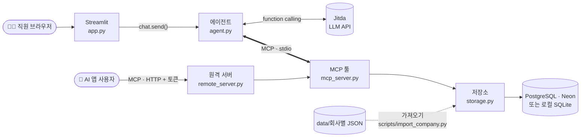

[← README](../README.md) · [직원 가이드](guide-employee.md) · [AI 앱 연결](guide-mcp.md) · [관리자 가이드](guide-admin.md) · **구조와 보안**

# 🏗 구조와 보안

## 🧩 아키텍처



| 계층 | 파일 | 역할 |
|---|---|---|
| 웹 UI | `app.py` | 온보딩 대시보드, 챗봇 패널, 신청 확인 카드 |
| 에이전트 | `agent.py` | LLM 툴 호출 루프, 세션 값 주입, 입력 검증, 장애 대응 |
| MCP 툴 | `mcp_server.py` | 툴 5개 + UI 전용 툴 4개, 권한 · 비품 규칙 검증, 티켓 저장 |
| 원격 서버 | `remote_server.py` | HTTP MCP 엔드포인트, 토큰 인증, 안내 홈페이지 |
| 저장소 | `storage.py` | SQLAlchemy Core로 DB 접근. 회사별 60초 캐시(`data_version` 확인), 티켓 발급 트랜잭션, 연결 재시도 |
| DB | PostgreSQL(Neon) / SQLite | `DATABASE_URL`이 없으면 로컬 `officegenie.db` |
| 가져오기 | `scripts/import_company.py` | JSON 검증 후 회사 단위로 DB 교체. JSON을 읽는 유일한 곳 |
| 원본 데이터 | `data/<company_id>/`, `seed/` | 회사별 표준 JSON 5종, 시연 초기화용 티켓 |

서버는 실행 중에 JSON을 읽거나 쓰지 않습니다. 테이블은 `companies`, `employees`(비밀번호 없음), `policies`, `search_config`, `locations`, `unregistered_places`, `handovers`, `equipment_rules`, `ticket_rules`, `tickets`이며 모두 `company_id`로 회사를 구분합니다. 티켓 생성은 번호 할당 · 10초 중복 방지 · 수량 검사 · 저장 · 번호 증가를 트랜잭션 하나로 처리합니다(PostgreSQL은 회사 행 잠금, SQLite는 `BEGIN IMMEDIATE`). 그래서 웹 화면과 원격 서버가 동시에 신청해도 번호가 겹치지 않습니다.

웹 화면은 stdio 방식이라 `streamlit run app.py` 하나로 UI, 에이전트, MCP 툴이 함께 뜹니다. 원격 서버는 같은 툴 함수를 그대로 쓰고, 신원만 토큰에서 가져옵니다. 그래서 툴 동작을 고치면 두 입구에 똑같이 반영됩니다.

UI 개발자용 연동 규격은 [ui_contract.md](ui_contract.md)에 있습니다.

## 🧰 MCP 툴

| 툴 | 입력 (LLM이 채우는 값) | 반환 | 서버 쪽 검증 |
|---|---|---|---|
| `search_policy` | `query` | 관련 조항 최대 3개 + `citation` | 회사 내규 1.5배 가중, 점수 미달 시 `NOT_FOUND` |
| `get_employee_info` | `target` (타인을 물었을 때만) | 본인 인사 정보 · 연차 | 타인 사번 · 이름 → `PERMISSION_DENIED` |
| `get_office_location` | `place` | 건물 · 층 · 구역 · 안내 | 미등록 장소 → `NOT_FOUND` |
| `get_handover_doc` | `department` (부서를 지정했을 때만) | 핵심 업무 · 사용 툴 · 1주 차 할 일 | 타 부서 → `PERMISSION_DENIED` (부서 별칭 인식) |
| `create_support_ticket` | `item`, `quantity`, `purpose`, `request_type` | 신청 요약 (`NEEDS_CONFIRMATION`) | 허용 품목, 1인 수량 한도, 처리 중인 중복 신청 |

원격 서버에는 `confirm_support_ticket`(사용자 동의 후 발급)과 `get_my_tickets`(내 신청 현황)가 추가됩니다. 모든 툴은 같은 형식으로 응답합니다.

```json
{ "ok": true, "code": "OK", "message": "", "data": { } }
```

## 🔒 보안 설계

"프롬프트로 부탁하기"가 아니라 **구조적으로 불가능하게** 만드는 것이 원칙입니다.

1. **LLM은 사번을 모릅니다.** 웹에서는 에이전트가 세션 값을, 원격 서버에서는 토큰이 신원을 정합니다. LLM이 보는 툴 인자에는 회사 · 사번이 없습니다.
2. **권한은 서버가 판단합니다.** 타인 정보, 타 부서 문서 요청은 MCP 툴에서 차단되고 고정 안내 문구가 반환됩니다.
3. **없는 건 없다고 말합니다.** 데이터에 없는 장소 · 규정은 `NOT_FOUND`로 반환되며, 시스템 프롬프트가 추측을 금지합니다.
4. **티켓은 사람이 확정합니다.** 웹에서는 [접수 확정] 버튼을 눌러야만 발급되고, 10초 안의 같은 신청이 반복되면(버튼 연타) 티켓은 하나만 생깁니다.
5. **표준 조문과 내규를 구분합니다.** 표준취업규칙 기반 조항은 "참고용"으로 표시합니다.
6. **에러가 화면을 깨지 않습니다.** 서버 연결 실패, LLM 장애, 응답 시간 초과(30초)는 안내 문구와 [다시 시도] 버튼으로 바뀌고, 파이썬 예외는 화면에 나오지 않습니다.
7. **API 키는 MCP 서버로 넘어가지 않습니다.** LLM 키는 에이전트에만 있고, MCP 서버 프로세스 환경에서는 제거됩니다.

## 🏢 다른 회사에 적용하기

`data/` 아래에 회사 폴더를 하나 추가하고 DB로 가져오면 됩니다. 코드는 건드리지 않습니다.

```text
data/
└── your-company/
    ├── policies.json    # 규정 (회사 내규 + 표준 참고 조문), 검색 키워드
    ├── employees.json   # 사원 (부서, 직급, 연차)
    ├── locations.json   # 장소 (건물, 층, 구역, 별칭), 미등록 장소 목록
    ├── handovers.json   # 부서별 인수인계서 (핵심 업무, 사용 툴, 1주 차 할 일)
    └── tickets.json     # 신청 내역, 허용 비품 목록, 1인 수량 한도, 안내 문구
```

폴더를 만든 뒤 가져오기를 실행합니다. 모든 JSON을 먼저 검사하고, 오류가 있으면 파일명과 항목 번호를 알려 주고 DB는 바꾸지 않습니다. `employees.json`의 `password`는 DB에 저장하지 않고, `position`은 없어도 됩니다.

```bash
python scripts/import_company.py data/your-company
```

포함된 가상 회사 두 곳이 같은 구조의 예시입니다.

| | (주)브릿지소프트 `bridgesoft` | (주)넥스트웨이브 `nextwave` |
|---|---|---|
| 사원 | 40명 · 7개 부서 | 40명 · 7개 부서 |
| 규정 | 120개 (내규 22 + 표준 참고 98) | 120개 (내규 22 + 표준 참고 98) |
| 장소 | 17곳 | 20곳 |
| 점심 식대 | 12,000원 | 15,000원 |
| 모니터 한도 | 1인 2대 | 1인 1대 |

> 회사, 사원, 내규는 모두 프로젝트용 가상 데이터입니다. 표준 참고 조문은 고용노동부 「표준취업규칙」(2026-02)을 바탕으로 합니다.

## 📁 프로젝트 구조

```text
officegenie/
├── app.py                 # 직원용 웹 화면 (Streamlit)
├── agent.py               # LLM ↔ MCP 에이전트
├── mcp_server.py          # MCP 툴 (stdio)
├── remote_server.py       # 원격 MCP 서버 (HTTP + 홈페이지 + 토큰 인증)
├── storage.py             # DB 저장소 (SQLAlchemy Core, PostgreSQL/SQLite)
├── data/                  # 회사별 JSON 5종 (가져오기 원본)
├── seed/                  # 시연 초기화용 tickets.json 원본
├── assets/                # 로고
├── docs/                  # 가이드 문서, UI 연동 규격, 화면 캡처
├── scripts/
│   ├── import_company.py  # JSON 검증 → DB 가져오기, 티켓 초기화
│   ├── cli_chat.py        # 터미널 테스트 채팅
│   └── issue_token.py     # 원격 서버 개인 토큰 발급 · 목록 · 폐기
├── tests/                 # pytest 73개 (API 키 없이 실행, 임시 SQLite)
└── requirements.txt
```

## 🧪 테스트

```bash
python -m pytest -q
```

API 키 없이 실행됩니다. 테스트마다 임시 SQLite에 `data/`를 가져오고 티켓을 seed로 초기화하므로 원본 `data/` · `seed/`는 바뀌지 않습니다. 운영 DB(`DATABASE_URL`)에는 절대 연결하지 않으며, `TEST_DATABASE_URL`이 있으면 DB를 쓰는 테스트(툴 · 에이전트 · 저장소)를 PostgreSQL 임시 스키마에서도 한 번 더 돌립니다(이때 총 134회 실행).

| 파일 | 개수 | 검증 내용 |
|---|---|---|
| `test_tools.py` | 29 | 규정 검색, 장소, 인수인계서, 권한 차단, 비품 화이트리스트 · 수량 한도, 다기업 |
| `test_agent.py` | 13 | 실제 MCP 서버 + 가짜 LLM: 사번 위조 무시, 확인 절차, 입력 검증, 장애 대응 |
| `test_jitda_llm.py` | 5 | Jitda API 연동 형식, 키 비노출 (외부 요청 없음) |
| `test_remote.py` | 5 | 원격 서버(별도 임시 SQLite): 잘못된 토큰 거부, 토큰별 신원 분리, 2단계 신청, 웹·원격 프로세스 동시 발급 시 번호 중복 없음 |
| `test_storage.py` | 21 | DB 가져오기 · 재가져오기 티켓 유지 · `--reset-tickets` 번호 · 삭제 반영 · 실패 시 롤백 · 오류 위치 · 비밀번호 미저장 · 캐시 · 동시 발급 · 로그에 주소 미노출 |

---

[← 관리자 가이드](guide-admin.md) · [README로 돌아가기](../README.md)
