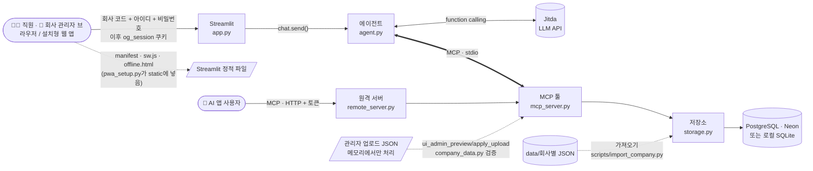

[← README](../README.md) · [직원 가이드](guide-employee.md) · [AI 앱 연결](guide-mcp.md) · [관리자 가이드](guide-admin.md) · **구조와 보안**

# 🏗 구조와 보안

## 🧩 아키텍처



| 계층 | 파일 | 역할 |
|---|---|---|
| 웹 UI | `app.py` | 로그인 · 회사 등록 · 비밀번호 변경, 메뉴형 화면(`?page=` 동기화). 사원: 홈(사원증) · 공지사항 · 자료실 · 비품 신청 + 챗봇. 관리자: 홈 · 공지사항 관리 · 자료실 관리 · 비품 관리 · 사원 · 데이터·계정 |
| 에이전트 | `agent.py` | LLM 툴 호출 루프, 세션 값 주입, 입력 검증, 장애 대응 |
| MCP 툴 | `mcp_server.py` | LLM용 툴 6개 + UI 전용 `ui_` 툴(로그인·세션 · 등록 · 홈 · 공지 · 자료실 · 비품 · 관리자), 권한 · 비품 규칙 · 자료 형식 검증, 티켓 저장 |
| 데이터 검증 | `company_data.py` | 문서 5종 검증 · 업로드 해석 · 변경 비교(파일·DB 접근 없음). CLI 가져오기와 관리자 업로드가 함께 사용 |
| 원격 서버 | `remote_server.py` | HTTP MCP 엔드포인트, 토큰 인증, 안내 홈페이지 |
| 저장소 | `storage.py` | SQLAlchemy Core로 DB 접근. 회사별 60초 캐시(`data_version` 확인), 티켓 발급 트랜잭션, 연결 재시도 |
| DB | PostgreSQL(Neon) / SQLite | `DATABASE_URL`이 없으면 로컬 `officegenie.db` |
| 가져오기 | `scripts/import_company.py` | JSON 검증 후 회사 단위로 DB 교체. 디스크의 JSON을 읽는 유일한 곳 |
| 운영 스크립트 | `scripts/list_companies.py`, `scripts/set_admin_password.py` | 회사 코드 확인, ADMIN 비밀번호 설정 |
| PWA | `pwa/`, `scripts/pwa_setup.py`, `scripts/make_pwa_icons.py` | manifest · 서비스 워커 · 오프라인 화면 · 아이콘, Streamlit 정적 폴더에 주입(멱등 · `--check` · `--undo`) |
| 업로드 양식 | `templates/*.json` | 관리자 화면 "양식 다운로드" 파일(필드 설명 + 예시 1건) |
| 원본 데이터 | `data/<company_id>/`, `seed/` | 회사별 표준 JSON 5종, 시연 초기화용 티켓 |

서버는 실행 중에 JSON 파일을 읽거나 쓰지 않습니다(관리자가 올린 JSON은 메모리에서 검증·가져오기만 하고 파일로 저장하지 않음). 테이블은 `companies`(+`company_code`), `accounts`, `audit_log`, `login_sessions`, `resources`, `employees`(비밀번호 없음), `policies`, `search_config`, `locations`, `unregistered_places`, `handovers`, `equipment_rules`, `ticket_rules`, `tickets`, `announcements`이며 모두 `company_id`로 회사를 구분합니다. 새 테이블은 `init_db()`의 `create_all`이 기존 DB에 안전하게 추가합니다(기존 행은 건드리지 않음). 티켓 생성은 번호 할당 · 10초 중복 방지 · 수량 검사 · 저장 · 번호 증가를 트랜잭션 하나로 처리합니다(PostgreSQL은 회사 행 잠금, SQLite는 `BEGIN IMMEDIATE`). 그래서 웹 화면과 원격 서버가 동시에 신청해도 번호가 겹치지 않습니다.

웹 화면은 stdio 방식이라 `streamlit run app.py` 하나로 UI, 에이전트, MCP 툴이 함께 뜹니다. 원격 서버는 같은 툴 함수를 그대로 쓰고, 신원만 토큰에서 가져옵니다. 그래서 툴 동작을 고치면 두 입구에 똑같이 반영됩니다.

UI 개발자용 연동 규격은 [ui_contract.md](ui_contract.md)에 있습니다.

## 🏢 멀티테넌트 구조

| 개념 | 설명 |
|---|---|
| `company_id` | 내부 키. 모든 테이블이 이 값으로 회사를 나눕니다. 웹 등록 회사는 `c_` + 난수로 자동 생성. 화면에 보이지 않습니다. |
| 회사 코드 (`companies.company_code`) | 로그인에 쓰는 공개 코드. 영문 대문자+숫자 6자리(0/O/1/I/L 제외), 유니크. 처음 등록·가져오기 때 한 번 만들고 다시 가져와도 바뀌지 않습니다. 로그인 시 대소문자·공백 무시. |
| `accounts` | `(company_id, account_id)` PK. 사원은 사번, 관리자는 `ADMIN`(회사당 1개). `role`, `password_hash`(scrypt, 비용 값 포함), `salt`(16바이트), `must_change`, `failed_count`, `locked_until`, `disabled`, `created_at`. |
| `audit_log` | `id, company_id, at, actor, action, target, detail(JSON)`. 회사 등록, 가져오기·업로드 반영, 계정 동기화, 잠금, 비밀번호 변경·초기화, 티켓 상태 변경, 관리자 조회(같은 조회는 5분에 1번)를 기록. 비밀번호 값은 기록하지 않습니다. |
| `tickets.history` | 관리자 상태 변경 이력 `[{at, by, from, to, note}]` |
| `login_sessions` | `token_hash`(SHA-256, PK), `company_id`, `account_id`, `created_at`, `last_seen_at`, `expires_at`. 새로고침 후 로그인 유지용. 토큰 원문은 저장하지 않습니다. |
| `resources` | `(company_id, resource_id)` PK. `title`, `category`, `description`, `kind`(file·link), `url`, `file_name`, `mime_type`, `size_bytes`, `content`(파일 바이트, 최대 5MB), `visibility`(all·department), `department`, `is_public`, `created_by`, `created_at`, `updated_at` |

**로그인과 격리**

1. 로그인(`ui_login`)은 회사 코드 → `company_id`로 바꾼 뒤 그 회사의 `accounts`만 봅니다. 회사 코드·아이디·비밀번호 중 무엇이 틀려도 같은 문구를 주고, 계정이 없어도 해시 계산을 해서 응답 시간 차이를 줄입니다. 같은 계정 5회 연속 실패 시 10분 잠금(사원 비밀번호는 4자리라 필수).
2. 로그인한 신원(`company_id`, `account_id`, `role`)은 `st.session_state`에만 있고 URL·입력으로 바꿀 수 없습니다. 30분 무동작 시 세션 전체를 지웁니다.
   - **새로고침 후 로그인 유지**: 로그인하면 서버가 무작위 토큰(`secrets.token_urlsafe(32)`)을 만들어 DB에는 해시만 저장하고, 브라우저에는 `og_session` 쿠키(SameSite=Strict, HTTPS면 Secure, 12시간)로 둡니다. 새로고침하면 `st.context.cookies`로 토큰을 읽어 `ui_resume_session`이 `accounts`에서 역할·잠금·비활성을 다시 확인하고 신원을 정합니다. 쿠키에는 회사·사번·역할이 없습니다.
   - 30분 무동작·12시간 경과·로그아웃·비밀번호 변경(해당 계정 세션 전부)·관리자 초기화·계정 비활성화 때 끝나고, 열린 화면도 5분마다 서버 세션을 다시 확인합니다.
   - 쿠키는 JavaScript로 쓰므로 HttpOnly가 아닙니다. 그래서 토큰은 해시로만 저장하고, 짧은 무동작 만료와 서버 측 폐기, 화면에 넣는 값의 HTML 이스케이프로 위험을 줄입니다.
   - **메뉴 주소**: `?page=`는 보여 줄 화면만 정합니다. 역할별 허용 목록에 없는 값은 홈으로 보내고, 사원이 관리자 메뉴 주소(`employees`, `data`)로 들어오면 감사 로그 `page_denied`를 남깁니다.
3. 관리자 툴(`ui_admin_*`)은 매번 `accounts`에서 `role=admin`인지 다시 확인합니다. 화면 분기만 믿지 않습니다. 실패하면 `PERMISSION_DENIED`.
4. 업로드는 파일 속 `company_id`·회사명을 버리고 로그인한 관리자의 `company_id`로만 반영합니다. 미리보기 시점의 `data_version`과 파일 해시를 반영 때 다시 확인하고(낙관적 잠금), 반영은 트랜잭션 하나로 처리해 실패하면 전부 되돌립니다. 비품·신청 규칙을 올려도 티켓과 다음 번호는 그대로입니다.
5. 로그인·세션·등록·관리자·자료실 툴은 `agent.py`의 `LLM_TOOLS`에 없습니다. LLM은 이 툴들을 볼 수도 부를 수도 없습니다.
6. **직원 화면 미리보기**(`ui_admin_preview_employee`)는 관리자 확인 후 같은 회사 사원만 보여 주고 감사 로그 `preview_employee`를 남깁니다. 화면은 읽기 전용이고, 관리자 세션으로는 `ui_confirm_ticket`이 `INVALID_SESSION`이라 티켓이 만들어지지 않습니다.

## 📁 자료실 권한

| 누가 | 무엇을 | 서버 확인 |
|---|---|---|
| 사원 | 목록(`ui_list_resources`) | `is_public`이고 `visibility=all` 또는 `visibility=department`이면서 부서가 본인 부서(`employees`의 값)인 자료만. 파일 바이트는 넣지 않음 |
| 사원 | 내려받기(`ui_download_resource`) | 같은 조건을 **다시** 확인. 다른 부서 전용·비공개·없는 자료는 모두 `DENIED_OR_NOT_FOUND` 고정 문구 |
| 관리자 | 목록·내려받기·저장·삭제(`ui_admin_*_resource`) | `accounts`에서 관리자 확인, 로그인한 회사의 자료만 |

- 업로드 검증: 확장자 허용 목록(pdf, docx, xlsx, pptx, hwp, png, jpg/jpeg, txt) + 파일 앞부분(형식 서명) 확인, 5MB 제한(디코딩 전에도 확인), MIME은 확장자로 서버가 결정, 파일명 정리(경로·제어 문자 제거), 링크는 `http/https`만.
- 모든 변경은 `audit_log`(`resource_created`·`resource_updated`·`resource_deleted`)에 남기고 파일 내용은 기록하지 않습니다.
- 규정집 탭은 `policies`를 카테고리별로 묶어 회사 내규를 먼저, 표준 참고 조문은 `is_reference_only`로 "참고용" 표시합니다. 부서 자료 탭은 소속 부서 인수인계서를 함께 보여 줍니다.

## 📲 PWA 구조

Streamlit은 앱 코드에서 `<head>`를 바꿀 수 없어서, 설치된 streamlit 패키지의 정적 폴더에 파일을 넣습니다.

| 파일 | 위치(서빙 경로) | 역할 |
|---|---|---|
| `pwa/manifest.webmanifest` | `/pwa/manifest.webmanifest` | 이름·시작 주소(`/?source=pwa`)·standalone·디자인 토큰 색·바로가기(공지사항·비품 신청·자료실) |
| `pwa/sw.js` | `/sw.js`(범위 `/`) | 서비스 워커 |
| `pwa/offline.html` | `/pwa/offline.html` | 연결이 끊겼을 때 보여 줄 화면(외부 리소스 없음) |
| `pwa/icon-*.png`, `apple-touch-icon.png` | `/pwa/…` | 192·512·maskable 512·180 아이콘(`make_pwa_icons.py`) |

- `scripts/pwa_setup.py`가 위 파일을 복사하고 `index.html` `<head>`에 manifest 링크, `theme-color`, `apple-mobile-web-app-*`, `apple-touch-icon`, 서비스 워커 등록 코드를 표시 주석 사이에 넣고 `viewport-fit=cover`(아이폰 안전 영역)를 더합니다. 멱등이며 `--check`, `--undo`(원본 그대로 복원)를 지원합니다. 링크에는 파일 해시(`?v=`)를 붙여 Streamlit의 긴 캐시를 피하고, 서비스 워커는 `updateViaCache: "none"`으로 등록합니다.
- **서비스 워커는 아이콘과 offline.html만 미리 저장**합니다. 페이지 이동은 네트워크 우선이고 실패하면 offline.html을 보여 줍니다. 페이지 응답, `/_stcore/`(웹소켓·상태 확인·업로드), 그 밖의 응답은 가로채거나 저장하지 않습니다(개인정보·실시간 연결).
- 서비스 워커와 설치는 **HTTPS 또는 localhost에서만** 동작합니다. 등록 코드는 `window.isSecureContext`일 때만 실행됩니다.
- `app.py`는 시작할 때 한 번 적용 여부를 확인해 미적용이면 서버 로그에 "python scripts/pwa_setup.py 실행 필요"를 남깁니다(화면 오류는 아님).
- streamlit 버전은 `requirements.txt`에 고정(`==`)합니다. 버전을 바꾸면 static 폴더가 새로 깔리므로 `pwa_setup.py`를 다시 실행하고 `tests/test_browser_mobile.py`로 manifest·서비스 워커·오프라인 화면을 확인합니다.

> 현재 MCP 서버는 `app.py`가 stdio로 띄우는 하위 프로세스라 `ui_` 툴은 웹 앱에서만 부를 수 있습니다. 관리자 툴은 app이 넘긴 `actor_account_id`를 `accounts`로 검증합니다. 원격으로 공개해야 할 때는 이번에 만든 로그인 세션 토큰(`login_sessions`)을 툴 인증에 쓰는 것이 다음 단계입니다.

## 🧰 MCP 툴

| 툴 | 입력 (LLM이 채우는 값) | 반환 | 서버 쪽 검증 |
|---|---|---|---|
| `search_policy` | `query` | 관련 조항 최대 3개 + `citation` | 회사 내규 1.5배 가중, 점수 미달 시 `NOT_FOUND` |
| `get_employee_info` | `target` (타인을 물었을 때만) | 본인 인사 정보 · 연차 | 타인 사번 · 이름 → `PERMISSION_DENIED` |
| `get_office_location` | `place` | 건물 · 층 · 구역 · 안내 | 미등록 장소 → `NOT_FOUND` |
| `get_handover_doc` | `department` (부서를 지정했을 때만) | 핵심 업무 · 사용 툴 · 1주 차 할 일 | 타 부서 → `PERMISSION_DENIED` (부서 별칭 인식) |
| `create_support_ticket` | `item`, `quantity`, `purpose`, `request_type` | 신청 요약 (`NEEDS_CONFIRMATION`) | 허용 품목, 1인 수량 한도, 처리 중인 중복 신청 |

| `get_my_tickets` | (없음) | 본인 신청만 최신순: 번호 · 품목 · 상태 · 신청일 · 최근 변경일 · 지급 예정일(정해진 경우만) · 최근 메모 | 세션의 사번으로만 조회 |

`get_my_tickets`는 "내 모니터 언제 받아?" 같은 질문에 씁니다. 지급 예정일은 관리자가 정한 `scheduled_date`가 있을 때만 알려 주고, 없으면 정해지지 않았다고 답하도록 시스템 프롬프트에 적었습니다(날짜를 지어내지 않음). 원격 서버에는 `confirm_support_ticket`(사용자 동의 후 발급)이 추가되고, 원격 `get_my_tickets`도 같은 함수를 씁니다. 모든 툴은 같은 형식으로 응답합니다.

```json
{ "ok": true, "code": "OK", "message": "", "data": { } }
```

## 🔒 보안 설계

"프롬프트로 부탁하기"가 아니라 **구조적으로 불가능하게** 만드는 것이 원칙입니다.

1. **LLM은 사번을 모릅니다.** 웹에서는 에이전트가 세션 값을, 원격 서버에서는 토큰이 신원을 정합니다. LLM이 보는 툴 인자에는 회사 · 사번이 없습니다.
2. **권한은 서버가 판단합니다.** 타인 정보, 타 부서 문서 요청은 MCP 툴에서 차단되고 고정 안내 문구가 반환됩니다.
3. **없는 건 없다고 말합니다.** 데이터에 없는 장소 · 규정은 `NOT_FOUND`로 반환되며, 시스템 프롬프트가 추측을 금지합니다.
4. **티켓은 사람이 확정합니다.** 웹에서는 [접수 확정] 버튼을 눌러야만 발급되고, 10초 안의 같은 신청이 반복되면(버튼 연타) 티켓은 하나만 생깁니다.
5. **표준 조문과 내규를 구분합니다.** 표준취업규칙 기반 조항은 "참고용"으로 표시합니다.
6. **에러가 화면을 깨지 않습니다.** 서버 연결 실패, LLM 장애, 응답 시간 초과(30초)는 안내 문구와 [다시 시도] 버튼으로 바뀌고, 파이썬 예외는 화면에 나오지 않습니다.
7. **API 키는 MCP 서버로 넘어가지 않습니다.** LLM 키는 에이전트에만 있고, MCP 서버 프로세스 환경에서는 제거됩니다.
8. **비밀번호는 해시로만 저장합니다.** 비밀번호·해시·솔트·DB 주소·API 키·가입 코드는 어떤 화면·로그·툴 응답에도 나오지 않습니다. 예외는 새로 만든 초기 비밀번호로, 반영·초기화 직후 관리자에게 한 번만 보여 주고 원문은 저장하지 않습니다.
9. **회사 목록을 공개하지 않습니다.** 로그인 화면에 회사 드롭다운이 없고, 원격 서버의 홈페이지·`/health`도 회사 ID를 보여 주지 않습니다.

## 🏢 다른 회사에 적용하기

기본은 **웹에서 회사 등록 → 관리자 화면에서 JSON 업로드**입니다([관리자 가이드 1부](guide-admin.md#1부-회사-관리자)). 운영자가 폴더로 넣을 때는 `data/` 아래에 회사 폴더를 하나 추가하고 DB로 가져오면 됩니다. 코드는 건드리지 않습니다.

```text
data/
└── your-company/
    ├── policies.json    # 규정 (회사 내규 + 표준 참고 조문), 검색 키워드
    ├── employees.json   # 사원 (부서, 직급, 연차)
    ├── locations.json   # 장소 (건물, 층, 구역, 별칭), 미등록 장소 목록
    ├── handovers.json   # 부서별 인수인계서 (핵심 업무, 사용 툴, 1주 차 할 일)
    └── tickets.json     # 신청 내역, 허용 비품 목록, 1인 수량 한도, 안내 문구
```

폴더를 만든 뒤 가져오기를 실행합니다. 모든 JSON을 먼저 검사하고, 오류가 있으면 파일명과 항목 번호를 알려 주고 DB는 바꾸지 않습니다. `employees.json`의 `password`는 `employees` 테이블이 아니라 `accounts`에 해시로만 들어가며(이미 계정이 있으면 덮어쓰지 않음), 비어 있으면 4자리 초기 비밀번호를 만들어 화면에 한 번만 출력합니다. `position`은 없어도 됩니다. 처음 가져오면 회사 코드가 만들어져 "회사명 / 회사 코드"로 출력됩니다.

```bash
python scripts/import_company.py data/your-company
```

포함된 가상 회사 두 곳이 같은 구조의 예시입니다.

| | (주)브릿지소프트 `bridgesoft` | (주)넥스트웨이브 `nextwave` |
|---|---|---|
| 사원 | 40명 · 7개 부서 | 40명 · 7개 부서 |
| 규정 | 120개 (내규 22 + 표준 참고 98) | 120개 (내규 22 + 표준 참고 98) |
| 장소 | 17곳 | 20곳 |
| 점심 식대 | 12,000원 | 15,000원 |
| 모니터 한도 | 1인 2대 | 1인 1대 |

> 회사, 사원, 내규는 모두 프로젝트용 가상 데이터입니다. 표준 참고 조문은 고용노동부 「표준취업규칙」(2026-02)을 바탕으로 합니다.

## 📁 프로젝트 구조

```text
officegenie/
├── app.py                 # 웹 화면: 로그인 · 회사 등록 · 메뉴형 사원/관리자 화면 (Streamlit)
├── agent.py               # LLM ↔ MCP 에이전트
├── mcp_server.py          # MCP 툴 (stdio)
├── remote_server.py       # 원격 MCP 서버 (HTTP + 홈페이지 + 토큰 인증)
├── storage.py             # DB 저장소 (SQLAlchemy Core, PostgreSQL/SQLite), 계정 · 감사 로그
├── company_data.py        # 회사 문서 검증 · 업로드 해석 · 변경 비교
├── templates/             # 관리자 업로드 양식 5종
├── data/                  # 회사별 JSON 5종 (가져오기 원본)
├── seed/                  # 시연 초기화용 tickets.json 원본
├── assets/                # 첫 화면 미리보기 이미지
├── pwa/                   # manifest · sw.js · offline.html · 아이콘 (pwa_setup.py가 Streamlit에 복사)
├── docs/                  # 가이드 문서, UI 연동 규격, 화면 캡처
├── scripts/
│   ├── import_company.py  # JSON 검증 → DB 가져오기, 티켓 초기화, 회사 코드 출력
│   ├── list_companies.py  # 회사 · 회사 코드 · 사원 수 목록 (운영자)
│   ├── set_admin_password.py  # 회사 ADMIN 비밀번호 설정 (운영자)
│   ├── pwa_setup.py       # Streamlit 정적 폴더에 PWA 적용 (--check, --undo)
│   ├── make_pwa_icons.py  # PWA 아이콘 생성 (Pillow)
│   ├── cli_chat.py        # 터미널 테스트 채팅
│   └── issue_token.py     # 원격 서버 개인 토큰 발급 · 목록 · 폐기
├── tests/                 # pytest 242개 (API 키 없이 실행, 임시 SQLite)
└── requirements.txt
```

## 🧪 테스트

```bash
python -m pytest -q
```

API 키 없이 실행됩니다. 운영 DB(`DATABASE_URL`)에는 절대 연결하지 않고 원본 `data/` · `seed/`는 바뀌지 않습니다.

- **기준 상태**: DB 종류마다 세션당 한 번 `data/`를 가져오고 티켓을 seed로 초기화합니다. 테스트가 끝나면 티켓 · 공지 · 계정 · 감사 로그 · 로그인 세션 · 자료실과 테스트가 등록한 회사만 기준 상태로 되돌립니다.
- **브라우저 테스트**(`test_browser_*.py`): Playwright가 없으면 건너뜁니다(개발용, requirements.txt에는 없음). PWA 확인은 `pwa_setup.py --check`가 통과할 때만 돌립니다.
- **`@pytest.mark.reimport`**: 회사 정적 데이터를 바꾸는 테스트(가져오기 · 업로드 · 규정 삭제). 끝난 뒤 테이블을 다시 만들고 다시 가져옵니다. 표시 없이 정적 데이터(`data_version`)를 바꾸면 그 테스트가 오류로 표시됩니다.
- **`@pytest.mark.pg`**: DB 종류에 따라 결과가 달라질 수 있는 테스트(스키마 생성 · 추가, 가져오기 트랜잭션과 롤백, 티켓 동시 발급 번호, 회사 코드 유니크, 로그인 잠금, 연결 재시도 · URL 마스킹). `TEST_DATABASE_URL`이 있으면 이 테스트만 PostgreSQL 임시 스키마에서 한 번 더 돌립니다. 전부 돌리려면 `pytest --pg-all`.
- **빠른 해시**: 테스트에서만 `OFFICEGENIE_TEST_FAST_HASH=1`로 scrypt 비용을 최소로 낮춥니다. 운영 비용(2^14)은 바꿀 수 없고, 해시에 비용이 함께 저장되어 섞여도 정확히 검증됩니다.

```bash
python -m pytest -q --durations=10                   # SQLite 전체 + (있으면) PostgreSQL pg 표시 테스트
python -m pytest -q -k "not postgresql"              # SQLite만 (약 2분, 브라우저 테스트 포함)
python -m pytest -q --pg-all                         # PostgreSQL에서도 전부 (오래 걸림)
```

| 파일 | 개수 | 검증 내용 |
|---|---|---|
| `test_tools.py` | 28 | 규정 검색, 장소, 인수인계서, 권한 차단, 비품 화이트리스트 · 수량 한도, 다기업 |
| `test_agent.py` | 14 | 실제 MCP 서버 + 가짜 LLM: 사번 위조 무시, 확인 절차, 입력 검증, 장애 대응, LLM에 보이는 툴 6개 |
| `test_jitda_llm.py` | 5 | Jitda API 연동 형식, 키 비노출 (외부 요청 없음) |
| `test_remote.py` | 5 | 원격 서버: 잘못된 토큰 거부, 토큰별 신원 분리, 2단계 신청과 get_my_tickets, 웹·원격 동시 발급 번호 중복 없음 |
| `test_storage.py` | 24 | DB 가져오기 · 재가져오기 티켓 유지 · 롤백 · 캐시 · 동시 발급 · 로그에 주소 미노출 |
| `test_accounts.py` | 22 | 회사 코드, 로그인 동일 문구·5회 잠금, 해시 저장, 초기 비밀번호, 응답에 비밀번호 없음, LLM 툴 목록 |
| `test_register.py` | 7 | 회사 등록·가입 코드·ADMIN 로그인, 빈 회사 처리, 관리자 권한 |
| `test_admin.py` | 29 | 업로드 검증·미리보기 DB 불변·반영, 회사 간 격리, 티켓 상태 흐름·이력, 계정 관리, 감사 로그 |
| `test_navigation.py` | 18 | 메뉴 이동·URL 동기화, 바로가기 후 로그인, 사원의 관리자 메뉴 주소 차단·감사 로그, 세션 토큰 해시 저장·복원·만료·폐기 |
| `test_home.py` | 7 | 사원증 홈 데이터(본인 것만), 관리자 홈, 직원 화면 미리보기(관리자·같은 회사 확인, 읽기 전용, 티켓 미생성, 감사 로그) |
| `test_notices.py` | 5 | 공개 공지만, NEW 배지·검색·펼치기, 관리자 목록에서 바로 수정·공개 전환 |
| `test_resources.py` | 30 | 부서 전용 자료 목록·다운로드 거부, 비공개, 형식·내용 불일치·5MB, 파일명 정리, 링크 검증, 관리자만 변경, 회사 간 격리, 감사 로그, init_db 테이블 추가 |
| `test_equipment.py` | 10 | get_my_tickets 본인 것만·관리자 변경 반영·예정일 미기재, LLM 사번 위조 무시, 남은 수량, 신청 폼→확인→확정→내역 |
| `test_pwa.py` | 14 | pwa_setup.py 멱등·--check·--undo 원본 복원, manifest·디자인 토큰 색, 아이콘 크기, 서비스 워커가 저장하지 않는 것, streamlit 버전 고정 |
| `test_app_login.py` | 17 | Streamlit AppTest: 로그인·로그아웃, 비밀번호 변경 우선, 자동 로그아웃, 회사 등록→관리자 메뉴, 업로드, 승인 → 사원 "지급 예정" |
| `test_browser_login.py` | 4 | 실제 브라우저 로그인·재시도 |
| `test_browser_mobile.py` | 3 | 390×844: 하단 탭 이동·터치 영역 44px·챗봇 버튼과 탭바 겹침 없음, 비품 신청·확정·내역, 새로고침 후 로그인 유지, 챗봇 전체 화면, PWA manifest·서비스 워커·오프라인 화면 |

---

[← 관리자 가이드](guide-admin.md) · [README로 돌아가기](../README.md)
