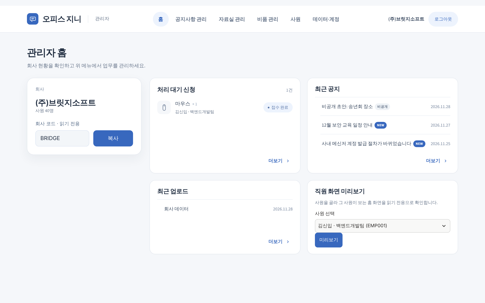

[← README](../README.md) · [직원 가이드](guide-employee.md) · [AI 앱 연결](guide-mcp.md) · **관리자 가이드** · [구조와 보안](architecture.md)

# 🛠 관리자 가이드

오피스지니를 쓰는 관리자는 두 종류입니다.

| 누구 | 하는 일 | 이 문서 |
|---|---|---|
| 🏢 **회사 관리자** (고객사 담당자) | 웹에서 회사 등록, 데이터 업로드, 사원 계정·신청 관리 | [1부](#1부-회사-관리자) |
| 🧑‍🔧 **서비스 운영자** (우리) | 서버 배포(AWS EC2), 가입 코드 관리, 운영 스크립트 | [2부](#2부-서비스-운영자) |

---

# 1부. 회사 관리자

설치할 것은 없습니다. 서비스 주소에 접속해 회사를 등록하고 데이터만 올리면 바로 사용할 수 있습니다.

## 1. 회사 등록

1. 첫 화면에서 **회사 등록**을 누릅니다.
2. 회사명과 관리자 비밀번호(8자 이상)를 입력합니다. 서비스 운영자가 가입 코드를 정해 두었다면 **서비스 가입 코드**도 입력합니다.
3. 등록이 끝나면 **회사 코드**(영문 대문자·숫자 6자리, 예: `MHUGS5`)가 크게 표시됩니다. 복사 버튼으로 복사해 두세요.
   - 같은 회사명으로 다시 등록해도 코드는 항상 새로 만들어집니다.

## 2. 관리자로 로그인

**"관리자로 로그인하기"** 를 누르면 회사 코드와 아이디 `ADMIN`이 자동으로 채워집니다. 다음부터는 로그인 화면에서 **회사 코드 + `ADMIN` + 관리자 비밀번호** 로 들어옵니다. 관리자 화면에는 챗봇이 없습니다.

관리자 메뉴는 **홈 · 공지사항 관리 · 자료실 관리 · 비품 관리 · 사원 · 데이터·계정**입니다. PC(1180px 이상)는 위쪽 메뉴,
태블릿·휴대폰은 아래쪽 탭바를 씁니다. 메뉴는 주소(`?page=equipment` 등)와 함께 바뀌어 새로고침해도 그 메뉴가 열립니다.
사원 계정으로 관리자 메뉴 주소(`?page=employees`, `?page=data`)를 열면 홈으로 돌아가고 감사 로그(`page_denied`)에 남습니다.

<p align="center"></p>

**홈**에는 회사 카드(회사명, 회사 코드와 복사 버튼, 사원 수), 처리 대기 신청, 최근 공지(비공개 표시), 최근 업로드가 있습니다.

## 3. 데이터·계정 메뉴: 데이터 올리기 (양식 → 업로드 → 미리보기 → 반영)

**데이터·계정** 메뉴 위쪽에 회사 코드가 있고, 아래에 **자료 업로드 · 사내 규정 · 계정** 탭이 있습니다.
처음 등록한 회사는 데이터가 비어 있어 "아직 회사 데이터가 없습니다. 자료 업로드에서 등록하세요."가 표시됩니다.

1. **양식 다운로드**: 종류별(규정·사원·장소·인수인계서·비품·신청 규칙) 양식에 필드 설명과 예시 1건이 들어 있습니다. `_안내` 항목과 예시는 지우거나 그대로 둬도 됩니다(업로드할 때 무시).
2. **파일 올리기**: `policies.json`, `employees.json`, `locations.json`, `handovers.json`, `tickets.json` 중 하나 또는 여러 개를 한 번에 올립니다. 파일당 2MB 이하, JSON만 가능합니다.
   - 파일 안의 `company_id`·회사명은 무시되고 항상 **내 회사**로 저장됩니다.
   - 문법 오류는 줄 번호로, 빠진 필드는 "파일 · 몇 번째 항목 · 필드 · 문제" 표로 알려 주고 아무것도 바꾸지 않습니다.
3. **미리보기**: 종류별 추가·수정·삭제 개수와 바뀐 항목 ID를 보여 줍니다. 이 단계에서는 아직 반영되지 않습니다.
4. **반영하기**: 한 번에(트랜잭션 하나로) 반영됩니다. 중간에 실패하면 전부 되돌립니다. 미리보기 이후 다른 반영이 먼저 있었다면 다시 미리보기를 만들라고 안내합니다.
   - 올린 종류만 바뀌고 나머지 종류는 그대로입니다. 올린 종류는 통째로 교체되므로 파일에서 뺀 항목은 삭제됩니다.
   - **비품·신청 규칙(tickets.json)** 은 허용 비품·수량 한도·안내 문구만 반영합니다. 기존 신청 내역과 다음 신청 번호는 바뀌지 않습니다.
   - 챗봇 답변에는 **최대 N초**(화면에 표시, 기본 60초) 안에 반영됩니다.

## 4. 사원에게 회사 코드와 초기 비밀번호 전달

- 사원 파일에 `password`를 넣으면 그 값이 초기 비밀번호가 됩니다(4자 이상).
- `password`를 비워 두면 4자리 초기 비밀번호를 만들어 **반영 직후 한 번만** 표와 CSV로 보여 줍니다. 서버에는 원문이 남지 않으니 바로 내려받거나 전달하세요. 이 사원들은 첫 로그인 때 비밀번호를 바꿔야 합니다.
- 이미 계정이 있는 사원은 사원 파일을 다시 올려도 비밀번호가 바뀌지 않습니다(사원이 바꾼 비밀번호 보존).
- 사원 파일에서 빠진 사원의 계정은 삭제되지 않고 로그인만 막힙니다(다시 넣으면 다시 열림).
- 사원에게는 **회사 코드 · 사번 · 초기 비밀번호** 를 알려 주고 [직원 가이드](guide-employee.md)를 공유하세요.

## 5. 메뉴별 관리

| 메뉴 · 탭 | 할 수 있는 것 |
|---|---|
| **공지사항 관리** | **＋ 공지 작성**, 목록에서 바로 **수정**(같은 자리에 폼이 열림), **공개하기/비공개로** 바로 전환. 공개 공지만 사원 공지사항·홈에 보입니다 |
| **비품 관리 › 비품 지급** | 비품 신청 목록·검색·상태 필터, 상세에서 지급 상태(접수/지급 예정/지급 완료)와 지급 예정일 |
| **비품 관리 › 신청 상태·이력** | 상태·부서 필터. 상태 변경은 `접수완료 → 검토중 → 승인 → 지급완료` 순서로만, `반려`는 사유를 적어야 가능. 변경 이력(시각·처리자·이전·이후·메모)이 남고 사원의 "내 신청 내역"과 챗봇 답변에 바로 반영됩니다(승인 = "지급 예정") |
| **사원 › 사원 목록** | 사원 추가·수정(부서, 직급, 잔여 연차, 재직 상태) |
| **사원 › 사원 상세** | 부서 필터, 이름·사번 검색. 행을 선택하면 인사 정보, 연차, 신청 내역, 소속 부서 인수인계서 요약 |
| **데이터·계정 › 사내 규정** | 챗봇이 답변에 쓰는 규정 원문 검색·열람 |
| **데이터·계정 › 계정** | 사원 계정 상태(정상/잠금/변경 필요/비활성), 비밀번호 초기화(새 4자리, 한 번만 표시), 잠금 해제, 관리자 비밀번호 변경. 비밀번호를 초기화하면 그 사원의 로그인 세션도 끝납니다 |
| **데이터·계정 › AI 앱 연결** | 사원이 홈에서 발급한 AI 앱 연결 토큰 현황(사번·이름·토큰 이름·발급일·마지막 사용·상태)과 **강제 폐기**. 토큰 원문은 저장하지 않아 관리자도 볼 수 없고, 폐기하면 그 AI 앱은 바로 연결이 끊깁니다 |

관리자의 조회·변경·업로드는 모두 감사 로그(`audit_log`)에 기록됩니다.

## 6. 자료실 관리

사원 **자료실**에 보일 파일과 링크를 관리합니다.

1. **＋ 자료 등록** → 제목, 카테고리(양식 · 가이드 · 교육 자료 · 부서 자료 · 기타), 설명(선택)
2. 종류: **파일**(pdf, docx, xlsx, pptx, hwp, png, jpg, txt · 파일당 5MB 이하) 또는 **링크**(`http://`·`https://` 주소만)
3. 공개 범위: **전체** 또는 **특정 부서**(그 부서 사원에게만 보임), **사원에게 공개** 켜기/끄기(끄면 관리자만 봄)
4. **저장**. 목록에서 **내려받기/열기 · 수정 · 삭제**(삭제는 한 번 더 확인)

- 형식·용량이 맞지 않으면 이유를 보여 주고 저장하지 않습니다. 확장자만 바꾼 파일(내용이 다른 형식)도 거부합니다.
- 파일 이름은 경로·특수 문자를 정리해 저장합니다. 수정할 때 새 파일을 고르지 않으면 기존 파일을 그대로 둡니다.
- 부서 전용 자료는 서버가 사원의 부서를 확인해 다른 부서에는 목록에도 보이지 않고 내려받기도 거부합니다.
- 등록·수정·삭제는 감사 로그(`resource_created`·`resource_updated`·`resource_deleted`)에 남습니다(파일 내용은 남기지 않음).

## 7. 직원 화면 미리보기

관리자 **홈 › 직원 화면 미리보기**에서 사원을 고르고 **미리보기**를 누르면 그 사원이 보는 홈(사원증·위젯)을 볼 수 있습니다.

- 위쪽 노란 띠에 "직원 화면 미리보기 · 이름(사번) · 읽기 전용"이 표시됩니다. **미리보기 닫기**로 돌아갑니다.
- 읽기 전용입니다. 신청·변경 버튼과 챗봇이 없고, 관리자 세션으로는 신청이 만들어지지 않습니다.
- **AI 앱 연결** 카드는 안내 문구만 보이고 토큰 발급·폐기 버튼이 없습니다. 서버도 관리자 세션의 발급·폐기를 거부합니다.
- 서버가 관리자 계정과 같은 회사 사원인지 다시 확인하고, 볼 때마다 감사 로그(`preview_employee`)를 남깁니다.

---

# 2부. 서비스 운영자

## 1. 설치

```bash
git clone https://github.com/Byun-Gwan-Young/OG.git officegenie
cd officegenie
python -m venv .venv

# macOS / Linux
source .venv/bin/activate
# Windows PowerShell
Set-ExecutionPolicy -Scope Process Bypass
.\.venv\Scripts\Activate.ps1

pip install -r requirements.txt
python -m pytest -q        # API 키 없이 실행, 임시 SQLite 사용
```

## 2. LLM API 키 설정

`env.example`을 복사해 `.env`로 저장하고 값을 채웁니다. `.env`는 저장소에 올라가지 않습니다.

```bash
LLM_API_KEY=발급받은 키
LLM_BASE_URL=https://.../v1      # Jitda 설정 화면의 API 주소
```

## 3. 데이터베이스 준비 (Neon PostgreSQL)

서버는 실행 중에 JSON 파일을 읽지 않고 **DB만** 씁니다. `data/`의 JSON은 DB에 넣기 위한 원본입니다.

1. [Neon](https://neon.tech)에서 프로젝트를 만들고 브랜치를 두 개 둡니다.
   - `main`: 실제 운영용
   - `dev`: 테스트·연습용 (운영 데이터와 분리)
2. 각 브랜치의 연결 주소(`postgresql://...`)를 복사해 `.env`에 넣습니다.

   ```bash
   DATABASE_URL=postgresql://사용자:비밀번호@호스트/DB이름?sslmode=require        # main 브랜치
   TEST_DATABASE_URL=postgresql://사용자:비밀번호@호스트/DB이름?sslmode=require   # dev 브랜치 (선택)
   ```

3. 회사 데이터를 DB로 가져옵니다.

   ```bash
   python scripts/import_company.py --all
   ```

   SQLite가 아닌 DB에 넣을 때는 비밀번호를 뺀 호스트, 회사, 작업 내용을 보여 주고 `y` 확인을 받습니다. 자동화할 때는 `--yes`를 붙입니다.

> 🔐 **DB 주소는 비밀번호가 들어 있는 비밀 정보입니다.** `.env`에만 두고 채팅·문서·스크린샷·커밋에 넣지 마세요. 서버 로그와 오류 메시지에는 주소가 나오지 않습니다.

- **테스트는 dev 브랜치에서만** 돌립니다. `pytest`는 `DATABASE_URL`(운영 DB)에 절대 연결하지 않고, 기본은 임시 SQLite입니다. `TEST_DATABASE_URL`이 있으면 그 DB에 임시 스키마를 만들어 DB 종류에 따라 결과가 달라질 수 있는 테스트(`@pytest.mark.pg`)만 한 번 더 돌린 뒤 지웁니다. 전부 돌리려면 `pytest --pg-all`(오래 걸림). 두 주소가 같으면 테스트가 바로 중단됩니다.
- **인터넷이 안 되거나 DB 없이 써 보고 싶으면**(로컬 개발 한정) `.env`에서 `DATABASE_URL` 줄을 지우세요. 프로젝트 폴더의 `officegenie.db`(로컬 SQLite)로 동작하며 시작 로그에 "로컬 SQLite 사용 중"이 나옵니다. 이 경우에도 처음 한 번은 `python scripts/import_company.py --all`을 실행합니다.
- DB가 비어 있으면 서버가 "python scripts/import_company.py --all을 먼저 실행하세요"라고 안내합니다. DB에 연결할 수 없으면 화면에는 "사내 시스템 연결이 일시적으로 원활하지 않습니다"가 나옵니다.

## 4. 웹 화면 실행

```bash
python scripts/pwa_setup.py     # 처음 한 번, 그리고 streamlit을 다시 설치·업그레이드할 때마다
streamlit run app.py
```

- `pwa_setup.py`는 설치된 streamlit 패키지의 static 폴더에 PWA 파일(manifest, 서비스 워커, 오프라인 화면, 아이콘)을
  복사하고 `index.html` `<head>`에 태그를 넣습니다. 여러 번 실행해도 한 번만 들어갑니다.
  - `python scripts/pwa_setup.py --check`: 적용 여부만 확인(적용됨이면 0)
  - `python scripts/pwa_setup.py --undo`: 넣은 태그와 파일을 원래대로 되돌림
  - 패키지 폴더에 쓸 권한이 필요합니다. 가상환경(.venv) 사용을 권장합니다.
- 적용하지 않고 실행하면 서버 로그에 "PWA 설정이 적용되지 않았습니다. python scripts/pwa_setup.py 실행 필요" 경고가 나옵니다(화면은 정상 동작).
- **서비스 워커와 홈 화면 설치는 HTTPS 또는 localhost에서만 동작합니다.** 직원 휴대폰에서 설치하게 하려면
  HTTPS 주소(EC2 배포의 Caddy 자동 인증서 등)로 서비스하세요. `http://192.168.x.x` 주소에서는 웹 화면은 되지만 설치는 안 됩니다.
- `requirements.txt`의 streamlit 버전은 고정(`==`)되어 있습니다. 버전을 바꾸면 `pwa_setup.py`를 다시 실행하고
  manifest 응답·서비스 워커 등록·오프라인 화면을 확인하세요(`pytest tests/test_browser_mobile.py`).

터미널에 나오는 `Network URL`(예: `http://192.168.0.10:8501`)을 직원들에게 공유합니다. 같은 네트워크에 있는 사람은 이 주소로 바로 접속할 수 있습니다.

- MCP 툴은 앱이 자동으로 띄우므로 따로 실행하지 않습니다.
- Windows에서는 처음 실행할 때 방화벽 창에서 "개인 네트워크 허용"을 선택하세요.

첫 화면에서 로그인(회사 코드 · 아이디 · 비밀번호) 또는 회사 등록을 고릅니다. 회사 목록은 화면에 나오지 않습니다.
로그인하면 `og_session` 쿠키(서버가 만든 무작위 토큰, SameSite=Strict, HTTPS면 Secure)로 새로고침해도 로그인이 유지됩니다.
DB에는 토큰의 해시만 저장되며, 30분 무동작·12시간 경과·로그아웃·비밀번호 변경/초기화·계정 비활성화 때 끝납니다.

## 5. AI 앱용 MCP 서버 실행 (선택)

```bash
python remote_server.py          # http://localhost:8000 (PORT 환경변수로 포트 변경)
```

| 주소 | 내용 | 토큰 |
|---|---|---|
| `/` | 안내 홈페이지 (앱별 연결 설정) | 불필요 |
| `/mcp` | MCP 엔드포인트 (Streamable HTTP) | **필요** |
| `/health` | 상태 확인 | 불필요 |

- **토큰은 사원이 직접 발급합니다.** 웹에 로그인해 홈의 **AI 앱 연결** 카드에서 이름을 붙여 발급하고(1인 최대 3개),
  필요 없어지면 폐기합니다. 원문은 발급할 때 한 번만 보입니다. 연결 방법은 [AI 앱 연결 가이드](guide-mcp.md)를 공유하세요.
- 토큰은 DB의 `mcp_tokens` 표에 **SHA-256 해시로만** 저장됩니다. MCP 서버는 요청마다 DB를 확인하므로
  발급·폐기가 **서버 재시작 없이 바로** 반영됩니다. 웹 서비스와 MCP 서버가 같은 `DATABASE_URL`을 써야 합니다.
- 회사 관리자는 **데이터·계정 > AI 앱 연결** 탭에서 사원별 토큰 현황(이름·발급일·마지막 사용일)을 보고 강제 폐기할 수 있습니다.
  발급·폐기·조회는 감사 로그에 남습니다. 계정이 비활성화·잠금되면 그 사원의 토큰도 거부됩니다.
- 사원 홈의 연결 안내에 나오는 주소는 `OFFICEGENIE_MCP_PUBLIC_URL`(예: `https://mcp.officegenie.example.com`)입니다.
  비어 있으면 "운영자가 아직 설정하지 않았다"고 표시됩니다.
- 운영자용 CLI (지원·점검용):

  ```bash
  python scripts/issue_token.py bridgesoft EMP001 --name "점검용"   # 발급 (원문은 이때 한 번만 출력)
  python scripts/issue_token.py --list [--all]                      # 목록 (--all: 폐기된 것 포함)
  python scripts/issue_token.py --revoke <토큰 원문>                 # 원문으로 폐기
  python scripts/issue_token.py --revoke-id bridgesoft <token_id>   # 목록의 token_id로 폐기
  ```

> 예전 방식의 `tokens.json`은 더 이상 읽지 않습니다. 남아 있다면 지워도 되며, 사원에게 홈에서 새 토큰을 발급받게 하세요.

## 6. AWS EC2 배포하기

EC2 서버 한 대에서 Docker Compose로 **웹(app.py) · 원격 MCP 서버(remote_server.py) · Caddy**를 함께 띄웁니다.
Caddy가 HTTPS 인증서를 자동으로 받아 오고, 바깥에서 들어온 요청을 웹·MCP로 넘깁니다. DB는 기존처럼 Neon PostgreSQL을 씁니다.

```
사원 브라우저 ──https──▶ ┌──────────── EC2 (Ubuntu 24.04) ────────────┐
사원 AI 앱   ──https──▶ │ Caddy :80/:443 ─┬─▶ web :8501 (Streamlit)    │ ──▶ Neon PostgreSQL
                         │                 └─▶ mcp :8000 (/mcp)         │     (DATABASE_URL)
                         └─────────────────────────────────────────────┘
```

> 🔐 **운영 비밀 값(DB 주소, LLM 키, 가입 코드)은 서버의 `.env.production`에만 둡니다.** 저장소·채팅·스크린샷에 넣지 마세요.
> `.env.production`은 `.gitignore`와 `.dockerignore`에 들어 있어 커밋되지 않고 이미지에도 들어가지 않습니다.
> 웹(8501)·MCP(8000) 포트는 바깥에 열지 않고 Caddy 뒤에만 둡니다.

필요한 파일은 저장소에 모두 있습니다.

| 파일 | 하는 일 |
|---|---|
| `Dockerfile` | 웹·MCP가 같이 쓰는 이미지(Python 3.15 slim, 빌드 때 `pwa_setup.py` 적용, root가 아닌 사용자로 실행) |
| `docker-compose.yml` | `web`, `mcp`, `caddy` 세 서비스. 자동 재시작, 헬스체크, 로그 크기 제한, 인증서 볼륨 |
| `Caddyfile` | `WEB_DOMAIN` → 웹, `MCP_DOMAIN` → MCP. 자동 HTTPS, 웹소켓·프록시 헤더 통과 |
| `env.production.example` | `.env.production` 형식 |
| `deploy/setup_server.sh` | 처음 한 번: Docker 설치, docker 그룹, 스왑, 자동 보안 업데이트 |
| `deploy/deploy.sh` | 업데이트할 때마다: pull → 빌드 → 시작 → 헬스체크 대기 → 이미지 정리 |
| `deploy/logs.sh`, `deploy/stop.sh` | 서비스별 로그 보기, 전체 중지 |

### 1) 리전을 서울로 고르기

AWS 콘솔에 로그인한 뒤 오른쪽 위 리전 메뉴에서 **아시아 태평양(서울) ap-northeast-2**를 고릅니다.
이후 만드는 인스턴스·탄력적 IP는 모두 이 리전에 있어야 합니다(리전이 다르면 목록에 안 보입니다).

### 2) EC2 인스턴스 시작

EC2 → **인스턴스 시작**에서 아래처럼 고릅니다.

| 항목 | 값 |
|---|---|
| 이름 | `officegenie` |
| AMI | **Ubuntu Server 24.04 LTS** (64비트 x86) |
| 인스턴스 유형 | **t3.small 권장**(2 vCPU, 메모리 2GB). t3.micro(1GB)도 되지만 빌드·챗봇 응답이 느릴 수 있습니다 |
| 키 페어 | **새 키 페어 생성**(RSA, `.pem`) 후 내 PC에 보관. 브라우저로만 접속할 거면 EC2 Instance Connect를 써도 됩니다 |
| 스토리지 | **20GB gp3** |

네트워크 설정은 3)에서 보안 그룹을 만들면서 정합니다.

### 3) 보안 그룹(방화벽)

인스턴스 시작 화면의 **네트워크 설정 → 편집**에서 새 보안 그룹을 만들고 인바운드 규칙을 이렇게 둡니다.

| 유형 | 포트 | 소스 | 이유 |
|---|---|---|---|
| SSH | 22 | **내 IP** | 서버 관리. 전체 공개하지 않습니다 |
| HTTP | 80 | 0.0.0.0/0 (전체) | 인증서 발급 확인과 https로 넘기기 |
| HTTPS | 443 | 0.0.0.0/0 (전체) | 웹·MCP 접속 |

- 8501·8000은 **열지 않습니다.** 웹·MCP는 Docker 내부 네트워크로만 Caddy와 연결됩니다.
- **브라우저의 EC2 Instance Connect**는 내 PC가 아니라 AWS 주소에서 SSH로 들어옵니다. SSH를 "내 IP"로만 열어 두면
  브라우저 접속이 막히므로, 쓰려면 SSH 규칙을 하나 더 추가하고 소스에 접두사 목록
  `com.amazonaws.ap-northeast-2.ec2-instance-connect`를 고릅니다.
- 집·학교처럼 내 IP가 바뀌면 보안 그룹의 SSH 소스를 다시 "내 IP"로 고칩니다.

### 4) 탄력적 IP 연결

EC2 → **탄력적 IP → 탄력적 IP 주소 할당** → 할당된 주소 선택 → **작업 → 탄력적 IP 주소 연결** → 인스턴스 `officegenie` 선택.
인스턴스를 껐다 켜도 주소가 바뀌지 않아 도메인을 다시 바꿀 필요가 없습니다. 이 주소를 메모해 둡니다.

### 5) 도메인 두 개 준비 (웹, MCP)

Caddy가 인증서를 받으려면 **도메인 이름이 이 서버의 탄력적 IP를 가리켜야** 합니다. 웹용·MCP용 두 개가 필요합니다.

- **구입한 도메인이 있으면**: DNS 관리 화면에서 A 레코드 두 개를 만듭니다.
  예: `officegenie.example.com` → 탄력적 IP, `mcp.officegenie.example.com` → 탄력적 IP
- **무료로 하려면 [DuckDNS](https://www.duckdns.org)**: 로그인 → 하위 도메인 두 개 추가(예: `officegenie-○○`, `officegenie-○○-mcp`)
  → 각각 **current ip**에 탄력적 IP를 넣고 **update ip**. 주소는 `https://<이름>.duckdns.org`가 됩니다.

확인: 내 PC에서 `nslookup <도메인>`을 실행해 탄력적 IP가 나오면 됩니다(반영에 몇 분 걸릴 수 있음).

### 6) 서버에 접속해 설치·배포

**접속**: EC2 → 인스턴스 선택 → **연결 → EC2 Instance Connect → 연결**(브라우저), 또는 내 PC에서

```bash
chmod 400 officegenie.pem
ssh -i officegenie.pem ubuntu@<탄력적 IP>
```

**처음 한 번 서버 준비** (Docker·Compose 설치, docker 그룹, 메모리 2GB 이하면 2GB 스왑, 자동 보안 업데이트):

```bash
git clone https://github.com/Byun-Gwan-Young/OG.git officegenie
cd officegenie
bash deploy/setup_server.sh
exit        # docker 그룹 적용을 위해 접속을 끊고 다시 접속합니다
```

**`.env.production` 작성** (다시 접속한 뒤):

```bash
cd officegenie
cp env.production.example .env.production
chmod 600 .env.production
nano .env.production      # 값을 채우고 Ctrl+O, Enter, Ctrl+X
```

| 키 | 값 |
|---|---|
| `DATABASE_URL` | Neon **main** 브랜치 연결 주소 |
| `LLM_API_KEY`, `LLM_BASE_URL` | Jitda 키와 주소 |
| `OFFICEGENIE_SIGNUP_CODE` | 회사 등록 가입 코드(비우면 누구나 등록) |
| `WEB_DOMAIN`, `MCP_DOMAIN` | 5)의 두 도메인(`https://` 없이) |
| `OFFICEGENIE_MCP_PUBLIC_URL` | `https://<MCP_DOMAIN>` |
| `ACME_EMAIL` | 인증서 안내 메일을 받을 주소 |
| `OFFICEGENIE_ENV` | `production` 그대로 |

**배포**:

```bash
bash deploy/deploy.sh
```

빌드에 몇 분 걸립니다(t3.micro는 더 오래). `web`, `mcp`, `caddy`가 모두 "정상"이 되면 끝입니다.
실패하면 그 서비스의 최근 로그 50줄이 나오고 멈춥니다. 처음 접속할 때 Caddy가 인증서를 받느라 몇 초 걸릴 수 있습니다.

**Neon 데이터 확인**: 내 PC의 `.env`에 같은 main 브랜치 `DATABASE_URL`을 두고 실행합니다.

```bash
python scripts/import_company.py --all          # 처음 한 번 (이미 있으면 티켓은 그대로)
python scripts/list_companies.py                # 회사 코드
python scripts/set_admin_password.py <company_id>
```

**나중에 코드를 고쳤을 때**는 서버에서 `bash deploy/deploy.sh`만 다시 실행합니다. 로그는 `bash deploy/logs.sh web`, `bash deploy/logs.sh mcp -f`,
전체 중지는 `bash deploy/stop.sh`(인증서와 DB는 그대로)입니다.

### 7) 점검

내 PC에서:

```bash
python scripts/warmup.py https://officegenie.example.com https://mcp.officegenie.example.com
python scripts/deploy_check.py https://officegenie.example.com https://mcp.officegenie.example.com
```

- `warmup.py`: 두 서비스가 응답하는지와 응답 시간을 표로 보여 줍니다.
- `deploy_check.py`: 웹 응답, PWA 파일(manifest·서비스 워커·오프라인 화면), HTTPS, MCP `/health`, 안내 홈페이지 주소,
  잘못된 토큰 거부(401)를 자동으로 확인하고, 직접 해 봐야 하는 항목을 수동 확인 목록으로 출력합니다. 실패가 0개면 종료 코드 0입니다.
- **휴대폰에서 PWA 설치 확인**: 휴대폰 브라우저로 `https://<WEB_DOMAIN>` 접속 → 홈 화면에 추가([직원 가이드](guide-employee.md#6-홈-화면에-추가-앱처럼-쓰기)).
- **MCP 연결 확인**: 사원으로 로그인 → 홈의 **AI 앱 연결**에서 토큰 발급 → 안내 명령으로 Claude Code에 연결 → "점심 식대 한도랑 내 남은 연차 며칠이야?"
  → 토큰 폐기 후 바로 401이 되는지.
- 마지막으로 회사 관리자에게 `https://<WEB_DOMAIN>`과 회사 코드를 전달합니다.

### 💸 비용 주의와 정리

인스턴스, 탄력적 IP, 디스크(EBS)는 **켜 두거나 남겨 두는 동안 계속 과금**됩니다(크레딧이 있으면 크레딧에서 차감).
인스턴스를 "중지"해도 디스크와 탄력적 IP 요금은 계속 나갑니다. 정확한 요금은 AWS 요금 페이지(서울 리전)에서 확인하세요.

**발표·시연이 끝나면** (서울 리전인지 먼저 확인):

1. EC2 → 인스턴스 → `officegenie` 선택 → **인스턴스 상태 → 인스턴스 종료(삭제)**. 데이터는 Neon에 있으므로 서버를 지워도 남습니다.
2. EC2 → **탄력적 IP** → 주소 선택 → **작업 → 탄력적 IP 주소 연결 해제** → **작업 → 탄력적 IP 주소 릴리스**.
   릴리스하지 않으면 연결되지 않은 IP도 계속 과금됩니다.
3. EC2 → **볼륨**에서 남은 볼륨(상태 "사용 가능")을 삭제, **스냅샷**에서 직접 만든 스냅샷이 있으면 삭제합니다.
4. DuckDNS를 썼다면 하위 도메인을 지우거나 그대로 둬도 됩니다(무료). 구입한 도메인의 A 레코드는 지워 둡니다.

**결제 알림 설정** (처음 계정을 만들었을 때 한 번):

- **AWS Budgets**: 결제 및 비용 관리 → **예산 → 예산 생성** → 템플릿 **월별 비용 예산**(또는 **제로 지출 예산**) → 금액(예: 10 USD)과 알림 받을 메일 입력.
  크레딧을 쓰는 중이라면 사용자 지정 예산의 고급 옵션에서 **크레딧 제외**를 체크해야 실제 사용량이 크레딧으로 가려지지 않습니다.
- **결제 알람(CloudWatch)**: 결제 및 비용 관리 → 결제 기본 설정 → **결제 알림 받기** 켜기 →
  리전을 **미국 동부(버지니아 북부) us-east-1**로 바꿔 CloudWatch → 경보 → 경보 생성 → 지표 **결제 → 총 예상 요금** → 기준 금액과 메일(SNS 주제) 지정.

## 7. 운영

| 하고 싶은 것 | 방법 |
|---|---|
| 회사 등록 제한 | `.env`에 `OFFICEGENIE_SIGNUP_CODE=<가입 코드>`를 두면 그 코드를 아는 사람만 회사를 등록할 수 있습니다. 비워 두면 누구나 등록(시연용). 가입 코드 값은 화면·로그·응답에 나오지 않습니다. |
| 회사 목록 · 회사 코드 확인 | `python scripts/list_companies.py` → company_id, 회사명, 회사 코드, 사원 수 |
| 관리자 비밀번호 설정·분실 | `python scripts/set_admin_password.py <company_id>` (화면에서 입력, 8자 이상). 자동화는 `--password '...'`. 계정이 없으면 만들고 잠금도 풉니다. |
| JSON 폴더로 회사 가져오기 | `python scripts/import_company.py data/<회사>` 또는 `--all`. 처음 가져올 때 회사 코드를 만들고 "회사명 / 회사 코드"를 출력합니다. 다시 가져와도 코드는 바뀌지 않습니다. `password`가 없는 사원의 초기 비밀번호는 이때 화면에 한 번만 출력됩니다. |
| 재가져오기와 신청 내역 | 이미 DB에 신청 내역이 있으면 티켓과 다음 티켓 번호는 그대로 둡니다("티켓은 기존 DB 상태 유지"). |
| 시연 후 신청 내역 초기화 | `python scripts/import_company.py --all --reset-tickets` (seed/의 티켓으로 교체, 이미 쓴 번호는 다시 쓰지 않음) |
| 시연 전 사원 비밀번호 되돌리기 | `python scripts/import_company.py --all --reset-employee-passwords` (employees.json의 password로 다시 해시, 잠금·실패 횟수 초기화, ADMIN 제외. 바꾼 인원 수만 출력) |
| 가져오기 오류 | JSON을 전부 검사한 뒤에 DB를 바꿉니다(관리자 업로드와 같은 검증). 오류가 있으면 파일명과 항목 번호를 보여 주고 아무것도 바꾸지 않습니다. |
| 기존 DB 업그레이드 | 서버·스크립트가 시작할 때 `init_db()`가 새 테이블(`accounts`, `audit_log`, `resources`, `login_sessions`, `mcp_tokens`)과 컬럼(`company_code`, 티켓 `history`)을 추가하고, 코드가 없는 회사에 회사 코드를 채웁니다. 기존 데이터는 그대로입니다. |
| PWA 설정 확인·되돌리기 | `python scripts/pwa_setup.py --check` / `--undo`. 아이콘을 바꾸려면 `assets/logo.png`를 두고 `python scripts/make_pwa_icons.py` 후 `pwa_setup.py` |
| 새 회사 추가 | 회사 관리자가 웹에서 직접 등록하는 것이 기본입니다. 폴더로 넣을 때는 [다른 회사에 적용하기](architecture.md#-다른-회사에-적용하기) |
| LLM 연결 확인 | `python scripts/cli_chat.py bridgesoft EMP001` (실패하면 `[오류 원인]` 출력) |

## 8. 문제 해결

| 증상 | 원인과 해결 |
|---|---|
| `requirements.txt`를 찾을 수 없음 | zip을 풀면 폴더가 한 겹 더 생깁니다. 안쪽 폴더로 `cd` 하세요. |
| `ModuleNotFoundError: dotenv` / `sqlalchemy` / `psycopg` | `pip install -r requirements.txt`를 다시 실행하세요. |
| 화면에 "사내 시스템 연결이 일시적으로 원활하지 않습니다" | DB 연결 실패입니다. 인터넷과 `.env`의 `DATABASE_URL`을 확인하세요. 급하면 `DATABASE_URL`을 지워 로컬 SQLite로 동작시킬 수 있습니다. |
| 로그인 시 "회사 코드, 아이디 또는 비밀번호가 올바르지 않습니다" | 어느 값이 틀렸는지는 일부러 알려 주지 않습니다. `list_companies.py`로 회사 코드를 확인하세요. 같은 계정으로 5번 연속 틀리면 10분간 잠기며, 회사 관리자가 계정 탭에서 바로 풀 수 있습니다. |
| 관리자 비밀번호 분실 | `python scripts/set_admin_password.py <company_id>` |
| 챗봇이 "불러오지 못했어요"만 표시 | `.env`의 `LLM_API_KEY`, `LLM_BASE_URL`을 확인하세요. `scripts/cli_chat.py`로 실행하면 `[오류 원인]`이 출력됩니다. |
| 다른 PC에서 웹 화면 접속 불가 | Windows 방화벽에서 "개인 네트워크 허용"을 선택하고, 같은 네트워크인지 확인하세요. |
| AI 앱에서 MCP 연결 시 401 | 토큰이 틀렸거나 폐기된 토큰, 또는 계정이 잠금·비활성 상태입니다. 사원이 홈의 AI 앱 연결 카드에서 새로 발급하면 바로 쓸 수 있습니다(재시작 불필요). 웹과 MCP 서버의 `DATABASE_URL`이 같은지도 확인하세요. |
| `deploy.sh`가 web 또는 mcp에서 실패 | 출력된 로그 50줄을 봅니다. "DATABASE_URL이 없습니다"면 `.env.production`을 확인하세요(운영 모드는 SQLite로 동작하지 않음). |
| https 주소가 열리지 않음 / 인증서 오류 | 도메인이 탄력적 IP를 가리키는지(`nslookup`), 보안 그룹에 80·443이 열려 있는지 확인하고 `bash deploy/logs.sh caddy`를 봅니다. |
| 화면에 `chevron_right`·`keyboard_arrow_down` 같은 글자가 보이고 아이콘이 깨짐 | 아이콘 글꼴을 받지 못한 것입니다. 최신 `Caddyfile`(HTTP/3 끔)로 `bash deploy/deploy.sh`를 다시 실행하세요. 보안 그룹에 UDP 443을 따로 열 필요는 없습니다. 브라우저에서는 한 번 새로고침합니다. |
| `permission denied ... docker.sock` | `setup_server.sh` 뒤에 접속을 끊고 다시 접속하지 않은 것입니다. |
| EC2 Instance Connect 접속 실패 | SSH 규칙 소스에 `com.amazonaws.ap-northeast-2.ec2-instance-connect` 접두사 목록이 있는지 확인하세요. |
| Windows에서 한글 깨짐 | `chcp 65001` 입력 후 다시 실행하세요. |
| 휴대폰에 "홈 화면에 추가/설치"가 안 나옴 | HTTPS 주소인지, `python scripts/pwa_setup.py --check`가 "적용됨"인지 확인하세요. streamlit을 다시 설치했다면 `pwa_setup.py`를 다시 실행합니다. |
| 새로고침하면 로그인이 풀림 | 30분 무동작·12시간 경과·비밀번호 변경 시에는 정상입니다. 브라우저가 쿠키를 막고 있지 않은지 확인하세요. |

## 9. 설정 값

| 환경 변수 | 기본값 | 설명 |
|---|---|---|
| `LLM_API_KEY` | (필수) | Jitda LLM API 키 |
| `LLM_BASE_URL` | (필수) | Jitda API 주소 (`/v1`로 끝나는 주소) |
| `OFFICEGENIE_LLM_TIMEOUT` | `30` | LLM 응답 대기 시간(초) |
| `DATABASE_URL` | (없으면 `./officegenie.db`) | PostgreSQL(Neon) 주소. 비밀 정보. 운영 모드에서는 필수 |
| `OFFICEGENIE_ENV` | (없음) | `production`이면 `DATABASE_URL` 필수(없거나 SQLite면 시작 실패) |
| `OFFICEGENIE_MCP_PUBLIC_URL` | (없음) | 사원에게 안내할 원격 MCP 공개 주소(예: `https://mcp.officegenie.example.com`) |
| `WEB_DOMAIN`, `MCP_DOMAIN`, `ACME_EMAIL` | (EC2 배포 필수) | Caddy가 인증서를 받을 두 도메인과 안내 메일. `.env.production`에만 둠 |
| `TEST_DATABASE_URL` | (선택) | 테스트 전용 DB(dev 브랜치) 주소. `DATABASE_URL`과 달라야 함 |
| `OFFICEGENIE_SIGNUP_CODE` | (없음 = 누구나 등록) | 회사 등록에 필요한 서비스 가입 코드 |
| `OFFICEGENIE_CACHE_TTL` | `60` | 관리자 반영 후 다른 서버 프로세스가 새 데이터를 확인하는 주기(초) |
| `OFFICEGENIE_LOG_LEVEL` | `INFO` | `DEBUG`로 두면 툴 호출마다 DB 왕복 횟수를 기록 |
| `PORT` / `OFFICEGENIE_PORT` | `8000` | 원격 MCP 서버 포트 (`PORT` 우선) |

---

[← AI 앱 연결](guide-mcp.md) · 다음 문서: [구조와 보안 →](architecture.md)
