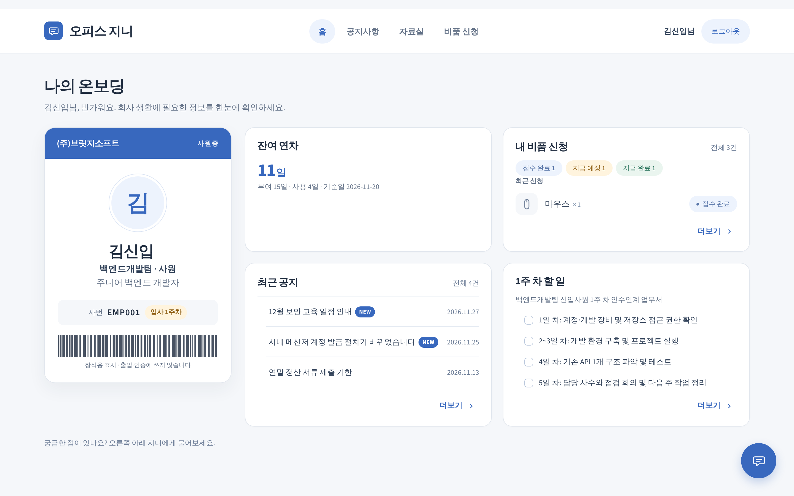
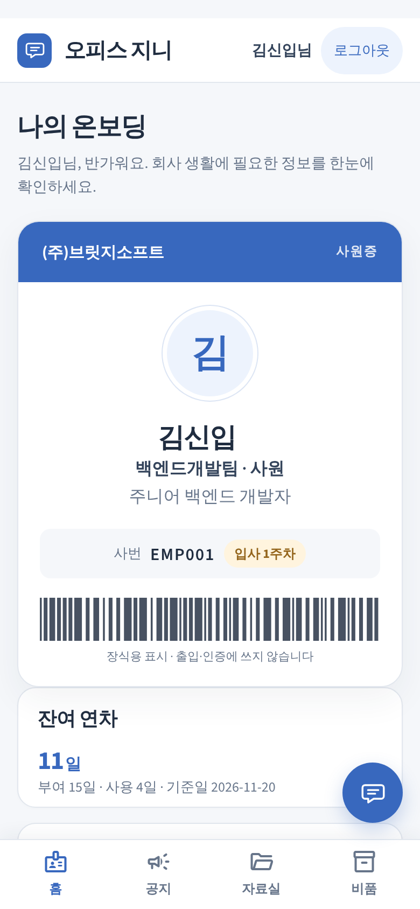
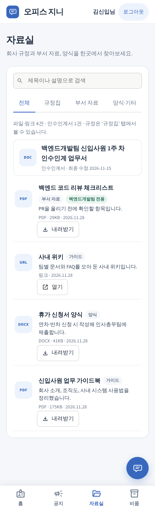
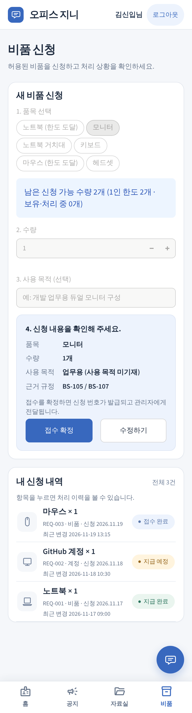

[← README](../README.md) · **직원 가이드** · [AI 앱 연결](guide-mcp.md) · [관리자 가이드](guide-admin.md) · [구조와 보안](architecture.md)

# 👩‍💼 직원 가이드: 웹·휴대폰에서 쓰기

설치할 것은 없습니다. 관리자에게 받은 주소로 접속해 로그인하면 됩니다. 휴대폰에서는 [홈 화면에 추가](#6-홈-화면에-추가-앱처럼-쓰기)해 앱처럼 쓸 수 있습니다.

## 0. 로그인하기

| 입력 칸 | 넣을 값 |
|---|---|
| 회사 코드 | 영문 대문자·숫자 6자리. **회사 관리자에게 받으세요.** 대소문자·앞뒤 공백은 신경 쓰지 않아도 됩니다. |
| 사번 | 내 사번 (예: `EMP001`) |
| 비밀번호 | 회사 관리자에게 받은 초기 비밀번호 |

- 초기 비밀번호로 처음 로그인하면 **비밀번호 변경 화면**이 먼저 나옵니다. 4자 이상, 이전과 다른 값으로 바꿔 주세요.
- 무엇이 틀렸는지는 알려 주지 않고 "회사 코드, 아이디 또는 비밀번호가 올바르지 않습니다."라고만 나옵니다.
- **같은 계정으로 5번 연속 틀리면 10분간 잠깁니다.** 기다리거나 회사 관리자에게 잠금 해제·비밀번호 초기화를 요청하세요.
- **새로고침해도 로그인이 유지됩니다.** 30분 동안 아무 조작이 없거나 로그인한 지 12시간이 지나면 다시 로그인해야 합니다.
- **로그아웃**을 누르면 대화 내용까지 모두 지워지고, 이 브라우저의 로그인도 끝납니다. 공용 PC에서는 꼭 로그아웃하세요.
- 관리자가 비밀번호를 초기화하면 열려 있던 화면도 몇 분 안에 로그아웃됩니다.

## 1. 메뉴

| 메뉴 | 하는 일 |
|---|---|
| **홈** | 사원증과 잔여 연차, 비품 신청 진행 상황, 최근 공지, 1주 차 할 일 |
| **공지사항** | 회사 공지 목록·검색, 제목을 누르면 내용이 펼쳐집니다. 7일 안에 올라온 공지에는 NEW |
| **자료실** | 규정집, 부서 자료(소속 부서 인수인계서 포함), 양식·기타 파일과 링크 |
| **비품 신청** | 허용된 비품 신청과 내 신청 내역(처리 이력) |

- **PC**: 화면 위쪽에 메뉴가 있습니다.
- **휴대폰**(화면 폭 768px 미만): 화면 아래쪽 탭바(홈 · 공지 · 자료실 · 비품)로 이동합니다.
- 메뉴는 주소에 `?page=notices`처럼 남아서 새로고침·뒤로가기·즐겨찾기가 그대로 동작합니다.
- 모든 메뉴의 오른쪽 아래 파란 버튼을 누르면 챗봇이 열립니다(휴대폰에서는 화면 전체).

## 2. 홈: 사원증

- 사원증에는 회사명, 이름 첫 글자, 부서·직급, 직무, 사번이 나오고, 온보딩 기간에는 "입사 N주차" 배지가 붙습니다.
- 사원증 아래 바코드는 **장식용**입니다. 출입이나 인증에 쓸 수 없습니다.
- 위젯마다 **더보기**를 누르면 해당 메뉴로 이동합니다. "1주 차 할 일"은 소속 부서 인수인계서 내용을 보여 주는 읽기 전용 목록입니다.

### AI 앱 연결 카드

홈 아래쪽 **AI 앱 연결** 카드에서 내가 쓰는 AI 앱(Claude Code, Cursor 등)에 오피스지니를 연결할 개인 토큰을 직접 만듭니다.

1. **토큰 이름**에 어디서 쓸지 적습니다(예: "회사 노트북 Claude Code").
2. **새 토큰 발급**을 누르면 토큰(`og_`로 시작)과 연결 방법(Claude Code 명령, Cursor JSON)이 나옵니다. 명령에는 회사 MCP 주소와 방금 만든 토큰이 이미 들어 있습니다.
3. 오른쪽 위 복사 버튼으로 복사해 AI 앱에 붙여 넣고 **확인했어요**를 누릅니다. **토큰은 이때 한 번만 보입니다.** 잃어버렸다면 폐기하고 새로 발급하세요.
4. **내 토큰** 목록에서 이름, 발급일, 마지막 사용일을 확인하고, 쓰지 않는 토큰은 **폐기**합니다. 폐기하면 그 앱은 바로 연결이 끊깁니다.

- 토큰은 한 사람당 **최대 3개**까지 만들 수 있습니다.
- 토큰은 내 신원과 같습니다. 다른 사람과 공유하지 마세요. 노출됐다면 바로 폐기하세요.
- 자세한 연결 방법은 [AI 앱에서 쓰기 (MCP)](guide-mcp.md)를 보세요.

## 3. 자료실

| 탭 | 내용 |
|---|---|
| 전체 | 내가 볼 수 있는 파일·링크와 소속 부서 인수인계서 |
| 규정집 | 회사 규정을 분류별로. 회사 내규가 먼저 나오고, 표준취업규칙 참고 조문에는 **참고용** 표시 |
| 부서 자료 | 소속 부서 인수인계서와 우리 부서 전용 자료 |
| 양식·기타 | 회사 전체에 공개된 양식과 안내 자료 |

- 위쪽 검색 칸에 제목이나 설명을 입력하면 걸러집니다.
- 파일은 **내려받기**, 링크는 **열기**를 누르세요.
- 다른 부서 전용 자료는 목록에 나오지 않고, 주소를 알아도 내려받을 수 없습니다.

## 4. 비품 신청

1. **품목 선택**: 회사가 허용한 품목만 나옵니다. 1인 한도를 이미 채운 품목에는 "한도 도달"이 붙습니다.
2. **남은 수량 확인**: "남은 신청 가능 수량 N개 (1인 한도 · 보유·처리 중)"가 나옵니다.
3. **수량·사용 목적** 입력 → **신청 내용 확인**
4. 확인 카드에서 품목·수량·목적·근거 규정을 보고 **접수 확정**을 누르면 신청 번호(예: `REQ-004`)가 발급됩니다. 고치려면 **수정하기**.

**내 신청 내역**에서는 상태(접수 완료 · 검토 중 · 지급 예정 · 지급 완료 · 반려)를 보고, 항목을 누르면 처리 이력과 반려 사유를 볼 수 있습니다. 관리자가 지급 예정일을 정하면 함께 표시됩니다.

> 확정 전에는 신청이 만들어지지 않습니다. 허용되지 않은 품목이나 한도를 넘는 수량은 서버가 이유를 안내하고 접수하지 않습니다.

## 5. 챗봇에게 물어보기

<table>
<tr>
<td align="center" width="33%"> <b>① 챗봇 열기</b> 추천 질문을 누르거나 직접 입력</td>
<td align="center" width="33%"> <b>② 규정 + 내 정보 답변</b> 핵심 요약 · 상세 기준 · 근거 조항</td>
<td align="center" width="33%"> <b>③ 챗봇으로 비품 신청</b> 내용 확인 후 [접수 확정]</td>
</tr>
</table>

| 궁금한 것 | 이렇게 물어보세요 |
|---|---|
| 회사 규정 | "점심 식대 한도가 얼마야?", "재택근무 신청은 어떻게 해?" |
| 내 정보 | "내 남은 연차 며칠이야?" |
| 사무실 위치 | "대회의실 어디야?", "프린터 몇 층이야?" |
| 내 업무 | "내 직무 인수인계서 요약해 줘", "1주 차에 뭐 해야 해?" |
| 비품 · 계정 신청 | "듀얼 모니터 1대 신청해 줘", "슬랙 계정 만들어 줘" |
| 내 신청 현황 | "내 모니터 언제 받을 수 있어?", "신청한 거 어떻게 됐어?" |

- 신청 현황은 본인 신청만 알려 줍니다. 관리자가 지급 예정일을 정하지 않았으면 "아직 정해지지 않았다"고 답하고 날짜를 지어내지 않습니다.
- 다른 직원의 연차, 다른 부서의 인수인계서, 회사에 등록되지 않은 정보는 보여 주지 않고 문의처를 안내합니다.
- 질문은 500자까지 입력할 수 있습니다. 챗봇 창을 닫으면 대화가 초기화됩니다. 답변이 오지 않으면 [다시 시도]를 누르세요.

## 6. 홈 화면에 추가 (앱처럼 쓰기)

오피스지니는 설치형 웹 앱(PWA)을 지원합니다. 홈 화면에 추가하면 주소창 없이 앱처럼 열리고, 아이콘을 길게 누르면 **공지사항 · 비품 신청 · 자료실** 바로가기가 나옵니다(안드로이드).

| 기기 | 방법 |
|---|---|
| 안드로이드 Chrome | 오피스지니 주소 접속 → 오른쪽 위 **⋮** → **홈 화면에 추가**(또는 **앱 설치**) → **설치** |
| iPhone Safari | 오피스지니 주소 접속 → 아래쪽 **공유 버튼(□↑)** → **홈 화면에 추가** → **추가** |
| PC Chrome · Edge | 주소창 오른쪽 **설치 아이콘(모니터에 ↓)** 클릭 → **설치**. 또는 **⋮** → **오피스지니 설치** |

- 설치는 **배포된 https 주소**(예: `https://officegenie.example.com`)에서 할 수 있습니다. `http://` 사내 IP 주소에서는 화면은 열리지만 설치 메뉴가 나오지 않습니다(같은 PC에서 여는 `localhost`는 예외). 설치 메뉴가 안 보이면 관리자에게 문의하세요.
- 인터넷이 끊기면 "인터넷에 연결되어 있지 않습니다" 화면이 나오고, 연결되면 자동으로 다시 열립니다. 개인정보가 담긴 화면은 휴대폰에 저장하지 않으므로 오프라인에서는 내용을 볼 수 없습니다.

---

다음 문서: [AI 앱에서 쓰기 (MCP) →](guide-mcp.md)
