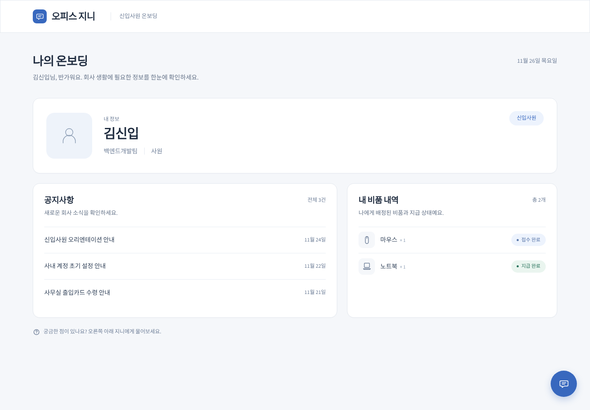
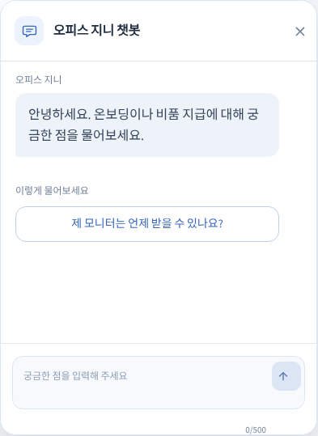
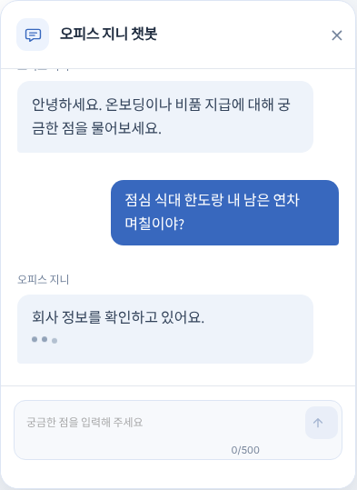
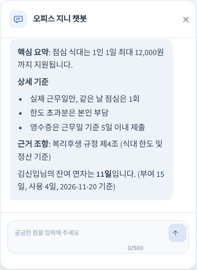
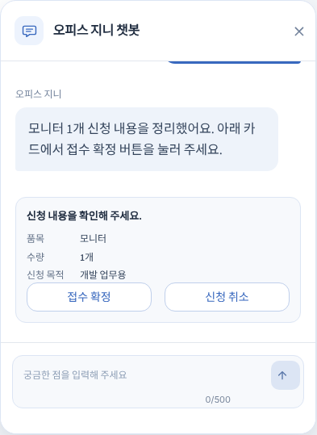
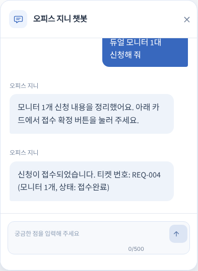
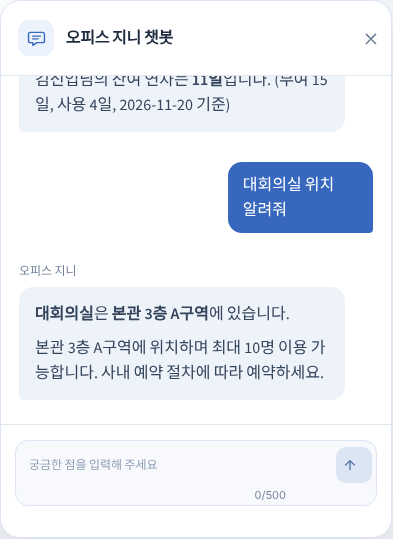
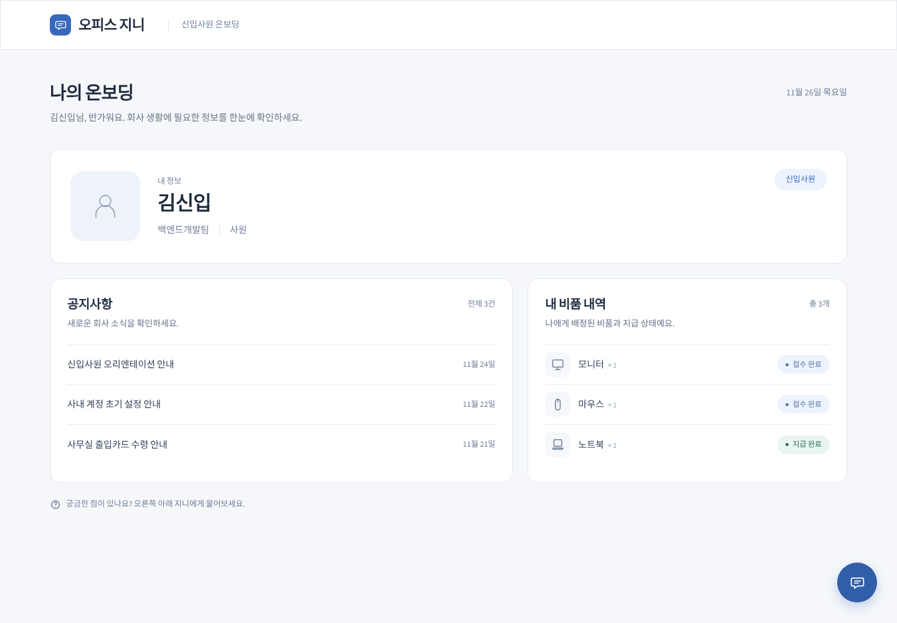
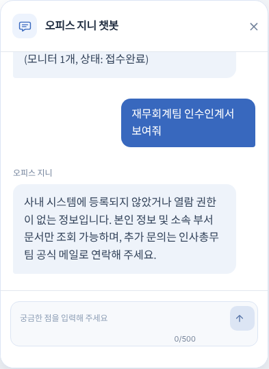

[← README](../README.md) · **직원 가이드** · [AI 앱 연결](guide-mcp.md) · [관리자 가이드](guide-admin.md) · [구조와 보안](architecture.md)

# 👩‍💼 직원 가이드: 웹에서 쓰기

설치할 것은 없습니다. 관리자에게 받은 주소로 접속만 하면 됩니다.

## 1. 접속하면 나의 온보딩 화면이 열립니다

관리자에게 받은 주소(예: `http://192.168.0.10:8501`)를 브라우저에 입력합니다. 내 정보, 공지사항, 내 비품 지급 상태를 한눈에 볼 수 있습니다. 오른쪽 아래 파란 버튼을 누르면 챗봇이 열립니다.

## 2. 챗봇에게 물어보기

<table>
<tr>
<td align="center" width="33%"> <b>① 챗봇 열기</b> 추천 질문을 누르거나 직접 입력</td>
<td align="center" width="33%"> <b>② 회사 데이터 확인 중</b> 답변이 준비되는 동안 입력이 잠깁니다</td>
<td align="center" width="33%"> <b>③ 규정 + 내 정보 답변</b> 핵심 요약 · 상세 기준 · 근거 조항</td>
</tr>
</table>

이런 질문을 할 수 있습니다.

| 궁금한 것 | 이렇게 물어보세요 |
|---|---|
| 회사 규정 | "점심 식대 한도가 얼마야?", "재택근무 신청은 어떻게 해?" |
| 내 정보 | "내 남은 연차 며칠이야?" |
| 사무실 위치 | "대회의실 어디야?", "프린터 몇 층이야?" |
| 내 업무 | "내 직무 인수인계서 요약해 줘", "1주 차에 뭐 해야 해?" |
| 비품 · 계정 | "듀얼 모니터 1대 신청해 줘", "슬랙 계정 만들어 줘" |

## 3. 비품 신청하기

신청은 바로 접수되지 않고, **내용을 확인한 뒤 확정해야** 티켓이 발급됩니다. 확정하면 대시보드의 "내 비품 내역"에 바로 나타납니다.

<table>
<tr>
<td align="center" width="33%"> <b>① 신청 내용 확인</b> 품목 · 수량 · 목적을 보고 [접수 확정]</td>
<td align="center" width="33%"> <b>② 티켓 발급</b> 티켓 번호(REQ-004)와 상태 안내</td>
<td align="center" width="33%"> <b>장소 안내 예시</b> 건물 · 층 · 구역과 이용 안내</td>
</tr>
</table>

 확정 직후 대시보드: 모니터가 "접수 완료"로 추가됨

> 회사가 허용하지 않은 품목이나 1인 수량 한도를 넘는 신청은 접수되지 않고 이유를 안내합니다.

## 4. 볼 수 없는 정보를 물으면

다른 직원의 연차, 다른 부서의 인수인계서, 회사에 등록되지 않은 정보는 보여주지 않고 문의처를 안내합니다. 챗봇이 추측해서 답을 지어내지 않습니다.

**알아두세요**

- 질문은 500자까지 입력할 수 있습니다.
- 챗봇 창을 닫으면 대화가 초기화됩니다.
- 답변이 오지 않으면 [다시 시도]를 누르세요.

 

> 화면은 실제 앱을 실행해 캡처했습니다. 답변 문구는 시연용 LLM 응답이며, 수치와 조항은 `data/bridgesoft/` 데이터 그대로입니다.

---

다음 문서: [AI 앱에서 쓰기 (MCP) →](guide-mcp.md)
