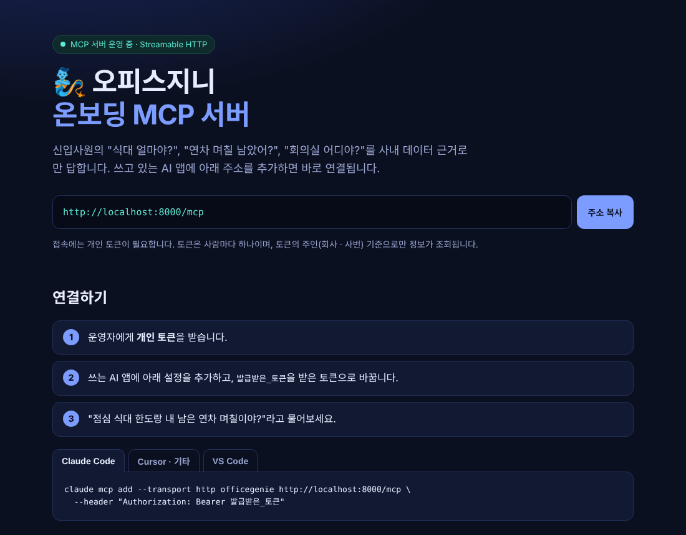

[← README](../README.md) · [직원 가이드](guide-employee.md) · **AI 앱 연결** · [관리자 가이드](guide-admin.md) · [구조와 보안](architecture.md)

# 🤖 AI 앱에서 쓰기 (MCP)

이미 Claude Code, Cursor, VS Code 같은 AI 앱을 쓰고 있다면, 그 앱에 오피스지니를 연결해 대화창에서 바로 물어볼 수 있습니다.

회사 파일을 AI 앱에 올리지 않습니다. 데이터는 회사 서버에 그대로 있고, AI 앱은 질문할 때마다 필요한 결과만 받아 갑니다.

```
나 ──질문──▶ 내 AI 앱 ──툴 호출──▶ 오피스지니 MCP 서버 ──▶ 회사 데이터
                       ◀──결과───
```

<p align="center"><br><sub>MCP 서버 주소로 접속하면 열리는 안내 홈페이지: 앱별 연결 설정을 복사할 수 있습니다</sub></p>

## 연결 방법

### 1. 홈에서 토큰 발급하기

1. 오피스지니 웹(예: `https://officegenie.onrender.com`)에 로그인합니다.
2. 홈 아래쪽 **AI 앱 연결** 카드에서 **토큰 이름**(예: "회사 노트북 Claude Code")을 적고 **새 토큰 발급**을 누릅니다.
3. 화면에 토큰(`og_…`)과 **이 토큰이 들어간 연결 명령**이 나옵니다. 복사 버튼으로 바로 복사하세요.
   **토큰은 이때 한 번만 보입니다.** 놓쳤다면 폐기하고 새로 발급하면 됩니다.

- 토큰은 한 사람당 최대 3개(예: 노트북용, 집 PC용)까지 만들 수 있습니다.
- 발급한 토큰은 **바로** 쓸 수 있습니다. 관리자에게 요청하거나 기다릴 필요가 없습니다.

### 2. AI 앱에 추가하기

카드에 나온 명령을 그대로 붙여 넣으면 됩니다. 형식은 아래와 같습니다(주소는 회사마다 다를 수 있으니 카드에 나온 값을 쓰세요).

**Claude Code**

```bash
claude mcp add --transport http officegenie https://officegenie-mcp.onrender.com/mcp \
  --header "Authorization: Bearer <발급받은 토큰>"
```

**Cursor · 기타 (JSON 설정)**

```json
{
  "mcpServers": {
    "officegenie": {
      "url": "https://officegenie-mcp.onrender.com/mcp",
      "headers": { "Authorization": "Bearer <발급받은 토큰>" }
    }
  }
}
```

**VS Code**

```json
{
  "servers": {
    "officegenie": {
      "type": "http",
      "url": "https://officegenie-mcp.onrender.com/mcp",
      "headers": { "Authorization": "Bearer <발급받은 토큰>" }
    }
  }
}
```

MCP 주소(`https://officegenie-mcp.onrender.com`)를 브라우저로 열면 앱별 설정을 복사할 수 있는 안내 홈페이지가 나옵니다.

### 3. 물어보기

AI 앱에서 "점심 식대 한도랑 내 남은 연차 며칠이야?"라고 물어봅니다.

### 4. 토큰 관리

- 홈의 **내 토큰** 목록에서 이름, 발급일, 마지막 사용일을 볼 수 있습니다.
- 쓰지 않는 기기의 토큰은 **폐기**하세요. 폐기하면 그 앱은 **바로** 연결이 끊깁니다.
- 회사 관리자도 사원별 토큰 현황을 보고 강제로 폐기할 수 있습니다. 관리자도 토큰 원문은 볼 수 없습니다(서버에는 해시만 저장).

## 쓸 수 있는 기능

| 툴 | 하는 일 |
|---|---|
| `search_policy` | 사내 규정 검색 (근거 조항 포함) |
| `get_employee_info` | 내 부서 · 직급 · 잔여 연차 |
| `get_office_location` | 사내 장소의 건물 · 층 · 구역 |
| `get_handover_doc` | 소속 부서 인수인계서 |
| `create_support_ticket` | 비품 · 계정 신청 요약 (아직 발급 안 됨) |
| `confirm_support_ticket` | 신청 확정, 티켓 발급 (내가 동의한 뒤에만) |
| `get_my_tickets` | 내 신청 현황 |

## 알아두세요

- **토큰이 곧 내 신원입니다.** 토큰에 연결된 회사 · 사번 기준으로만 정보가 조회되고, 다른 사람의 정보를 지정할 방법은 없습니다.
- **토큰은 공유하지 마세요.** 잃어버렸거나 노출됐다면 홈에서 바로 폐기하고 새로 발급하세요.
- **비품 신청은 두 단계입니다.** AI 앱이 신청 요약을 보여주면, 확인하고 동의해야 티켓이 발급됩니다.
- **연결이 안 되면(401):** 토큰을 잘못 붙여 넣었거나 폐기된 토큰입니다. 홈에서 새로 발급해 다시 넣어 보세요. 계정이 잠겼거나 비활성화된 경우에도 거부됩니다.
- **첫 연결이 느리면:** 한동안 사용이 없으면 서버가 잠들어 깨는 데 최대 1분쯤 걸립니다. 잠시 뒤 다시 시도하세요.

---

[← 직원 가이드](guide-employee.md) · 다음 문서: [관리자 가이드 →](guide-admin.md)
